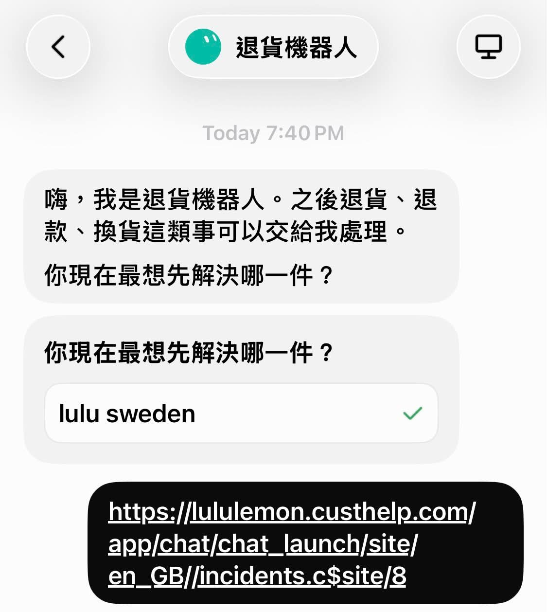
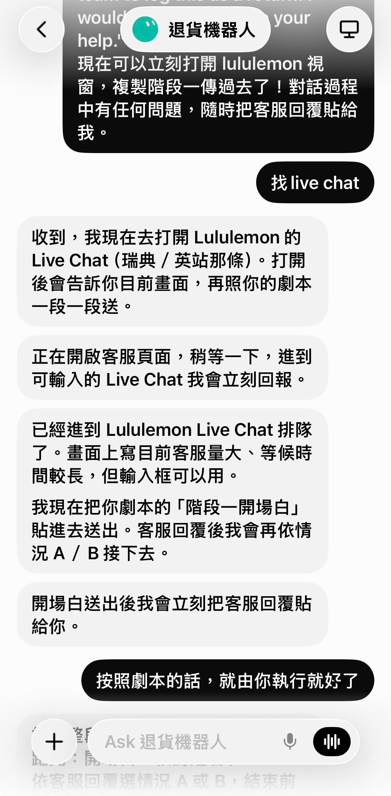
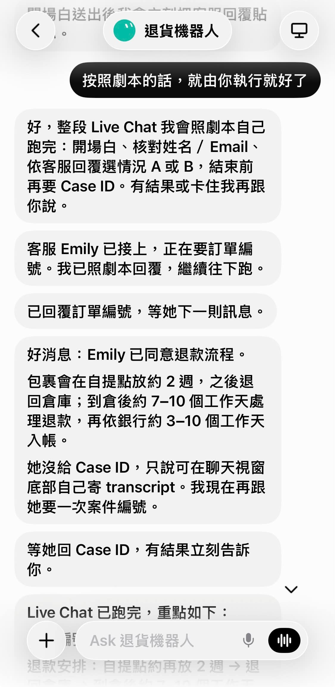
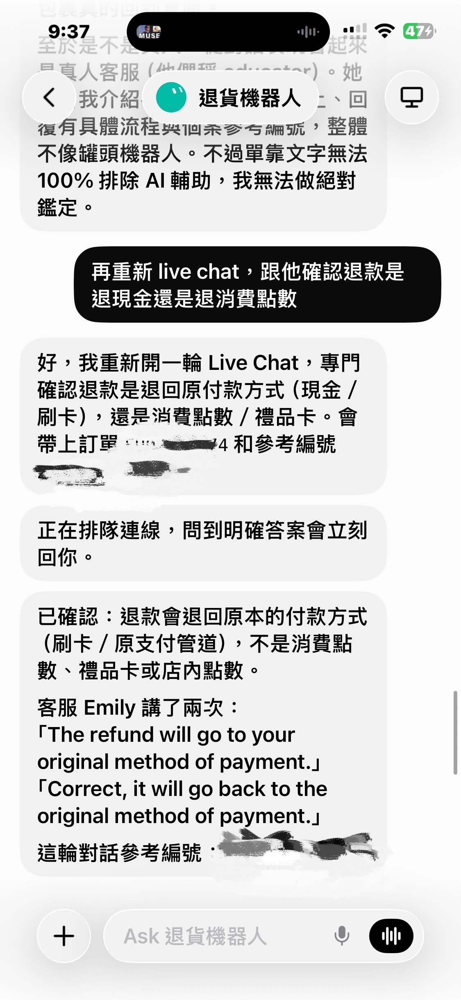

# Meta Muse Is Next-Level: It Handled My Lululemon Return

**Date:** 2026-09-26

---

Meta Muse is honestly next-level

We'd already zipped out of Sweden
The Lululemon parcel still hadn't made it to the hotel
It was stuck at a pickup point in Gothenburg
My wife told me to deal with it
I was on the verge of despair
DPD: Come on, pick it up yourself
Me: I'm out of the country now, okay?
And I was terrified that
the parcel would get lost on the way back

I went looking for customer service myself
Saw the support was an AI, and there was still a queue, and I just ran out of steam
So I dumped the whole thread of info on Muse
And told it: get into live chat and play the whole scene out for me

Then I went off to scroll my phone
Seriously didn't touch it again

And it actually went in and waited in the queue
Told the AI to get a real agent
Landed one named Emily
Told her the person had left, couldn't pick up the parcel, wanted a refund
Emily got it instantly: back to the warehouse → refund
Muse reported back with the case number
Me, in that moment: ??? It went that smoothly?

Then it suddenly hit me
If the refund came back as points or a gift card, that'd be a pain
That kind of fake refund would make me livid

So I sent Muse back in one more time
To ask: refund in cash or in points?

Muse double-checked
She said: yes, original payment

Two rounds of live chat
I didn't type a single word
My only jobs were taking screenshots and scrolling my phone

Next time you're on the verge of tears writing English emails to customer service
Just outsource it to Muse
Don't tough it out
P.S. Afterward, lulu emailed me an extra $30 coupon
I suspect Muse may have overacted a bit

## Replies

> Reader: But the screen you opened is Grok bot?

Holy crap, I'm dying🤣🤣🤣
Yeah, it is
I'd also bought Grok bot at $100 at the same time
But Muse can do it too
Everyone should just start with the free one

> Reader: Don't tell me there's a part-time student behind it🤣

LOL
Back to the human kind of "artificial intelligence" again

> Reader: It's not playing chat toy, it's buying back time for its user. Lots of people look at AI agents and only crunch compute costs, overlooking that on the consumer side it can directly solve high-friction pain points in everyday life. Customer service bots used to be a firewall that saved companies money at the consumer's expense, but once users also hold a negotiating tool like Muse, one that queues on its own, handles multi-turn conversations, and can even overact its way into a $30 coupon for its owner, the rules of the whole customer service game get completely rewritten!

Totally agree
Emails, returns, it's unbeatable at this stuff
It just keeps pestering them anyway
and it costs you nothing
People used to give up fast because it was a pain and the time cost was high
Let the AIs fight magic with magic
and it even feels like settling in to watch the show

> Reader: I use it myself and it really is super convenient.

So satisfying

---

Original post: https://www.threads.com/@edgeless.blade/post/Ddvffn1Dl69
