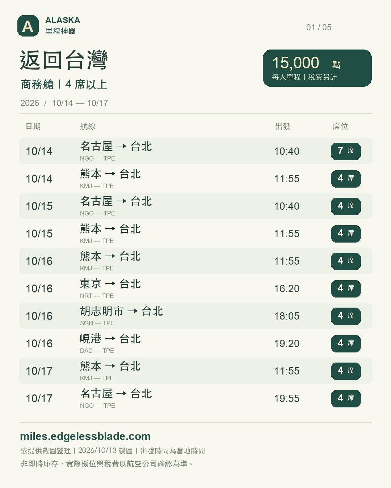
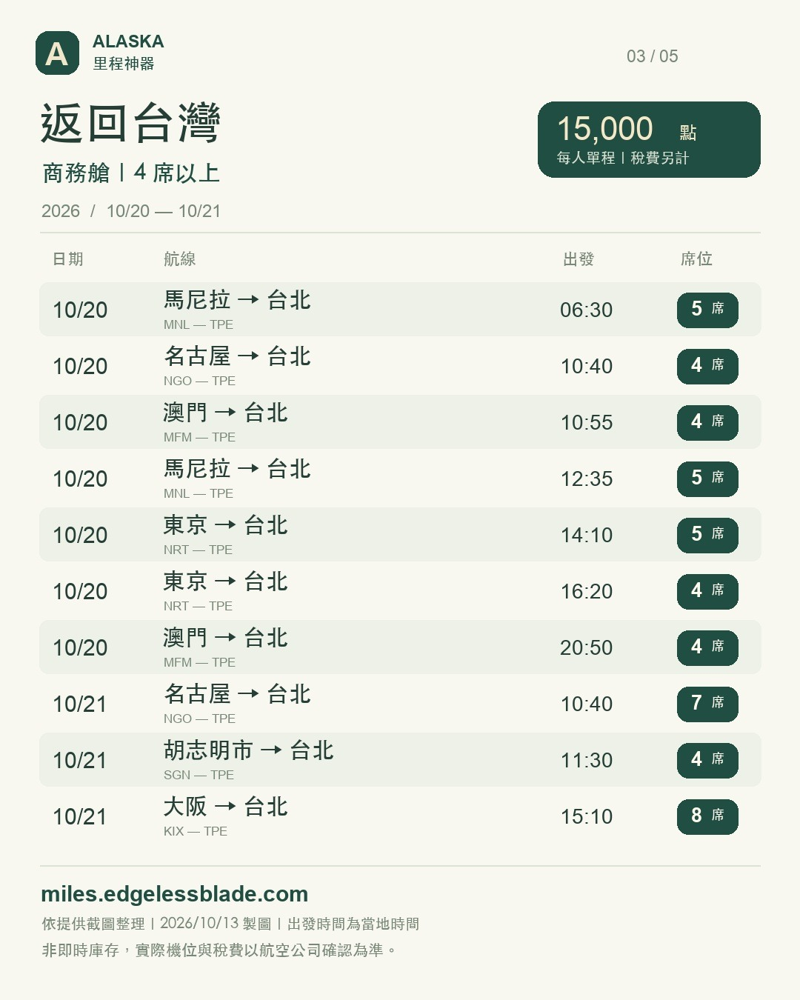
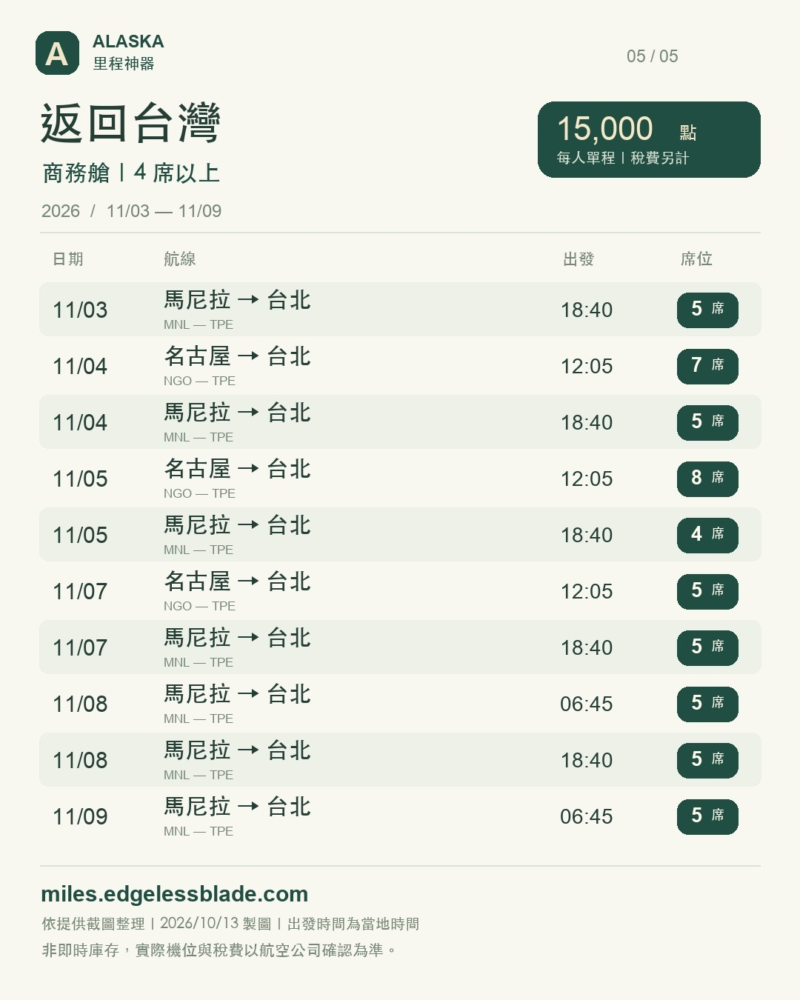
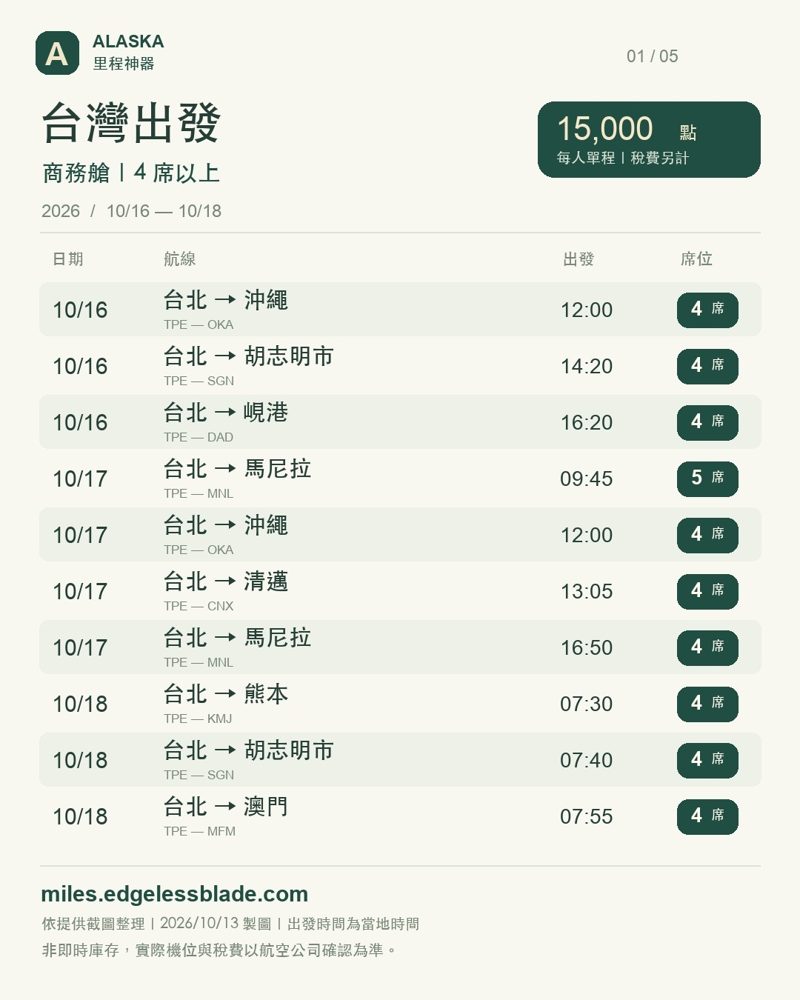
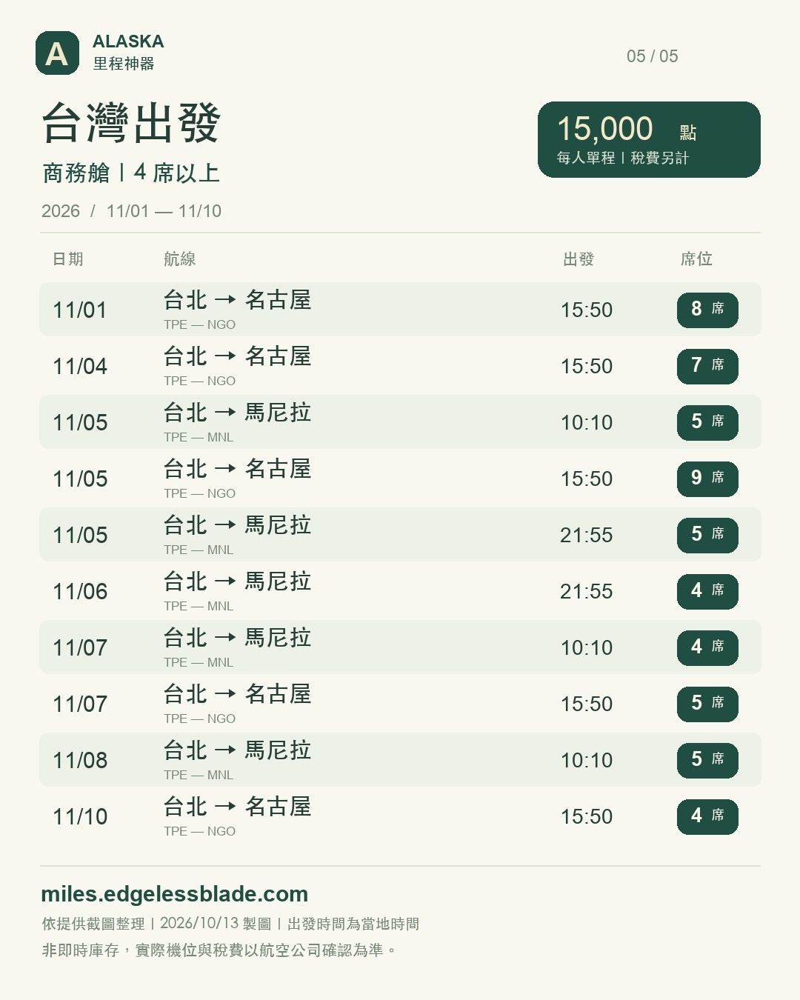

# Alaska Miles Are Ridiculously Easy Right Now — I Booked Eight Business Awards

**Date:** 2026-10-13

---

Even I'm shocked.

Alaska miles have been way too easy to redeem lately.

Nagoya back to Taiwan: business class casually has four or five seats open.

I just saw one with seven.

Kumamoto, Tokyo, Da Nang, Ho Chi Minh City, Manila, Hong Kong, Macau — 15,000 points one-way, and every single one starts at 4 seats.

Halfway through fixing bugs on my own website, I went back and forth and booked eight business-class seats in total 😅

I wasn't even planning to travel, but there are just way too many award seats.

If you see a flight showing four seats and can't book it, that's me — I grabbed them 🤣

The site no longer requires a login

to see award seats from the last seven days.

[miles.edgelessblade.com/recent](https://miles.edgelessblade.com/recent)

And Alaska's points sale runs through October 19.

---

Original post: https://www.threads.com/@edgeless.blade/post/DebusnoEzQ_
Part 2: https://www.threads.com/@edgeless.blade/post/Debu0khEwh7
