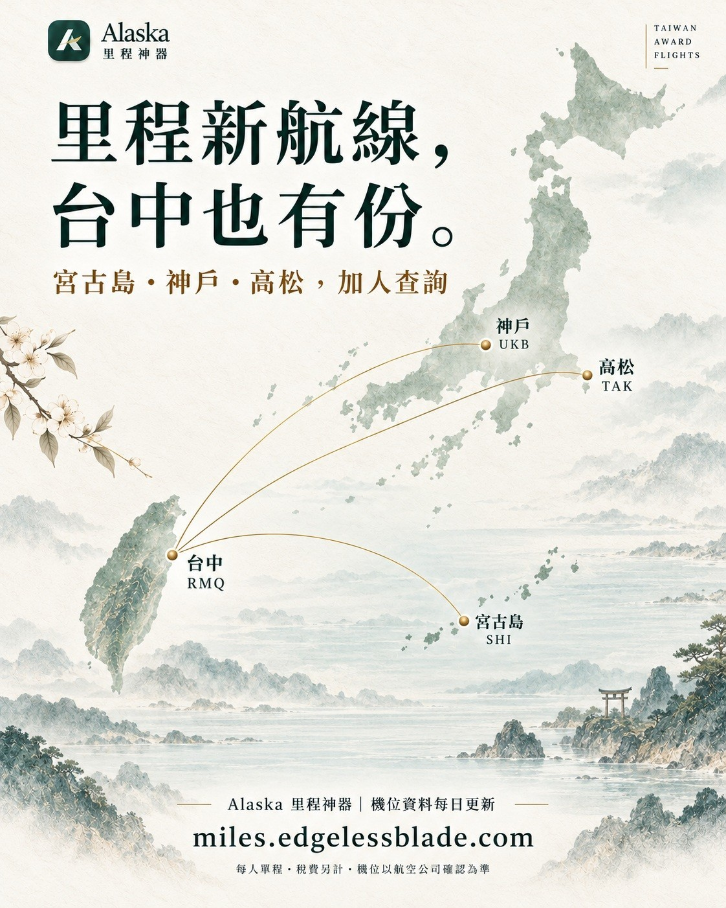
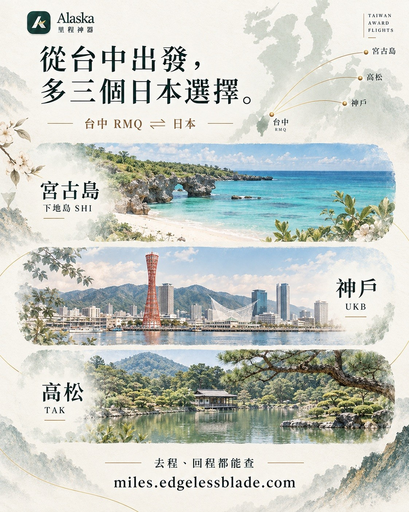

# Alaska Search Site Adds 4 More Destinations

**Date:** 2026-10-15

---

The Alaska award search site just added 4 more destinations

Loads of new flights out of Taichung
Kobe UKB 1,337 flights
Miyako SHI 406 flights
Takamatsu TAK 281 flights

New from Taipei
Sendai SDJ 476 flights

And then there's that Gemini Veo video
the images, characters, lip sync and scene transitions are all pretty good
so what's up with the accent?
The more I listen, the more hooked I get

Can I still hold on to my GOOG shares?

---

Original post: https://www.threads.com/@edgeless.blade/post/Deg-z5IDlXx
