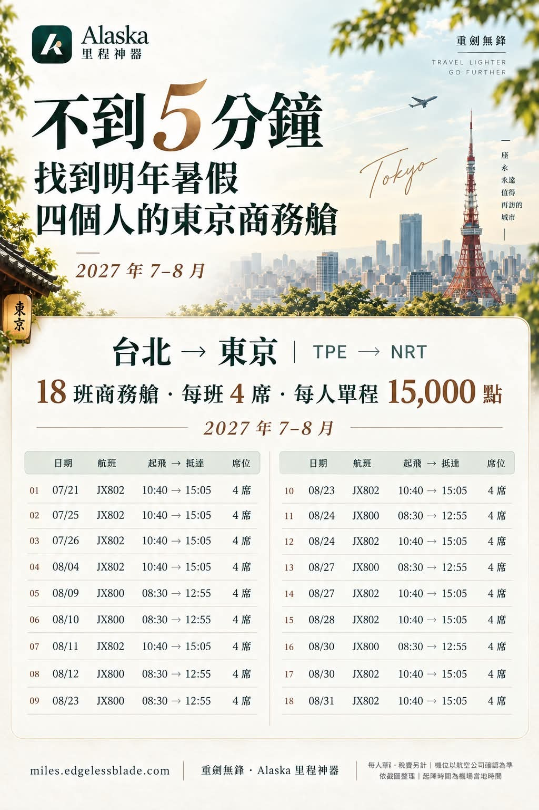
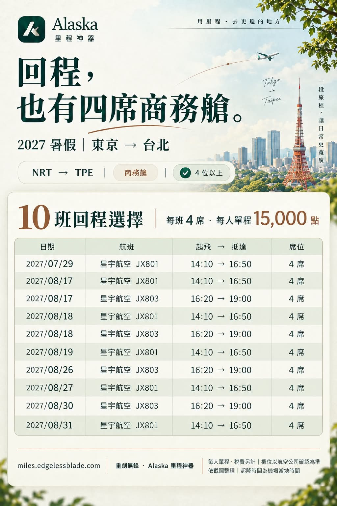
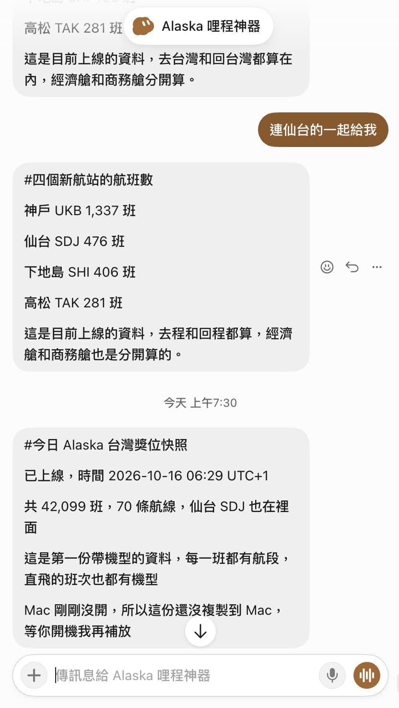
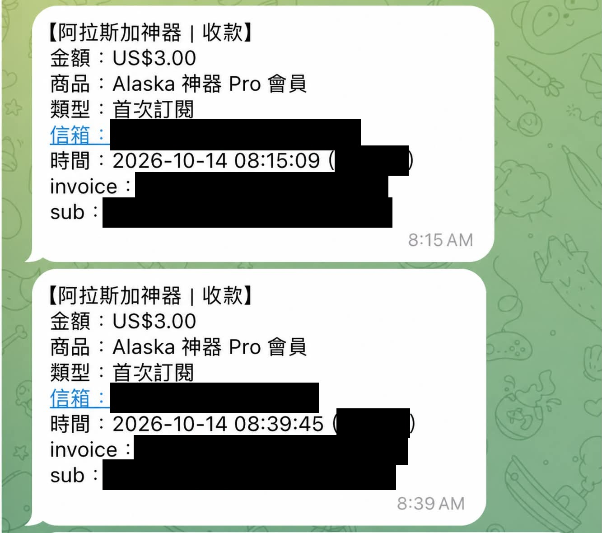
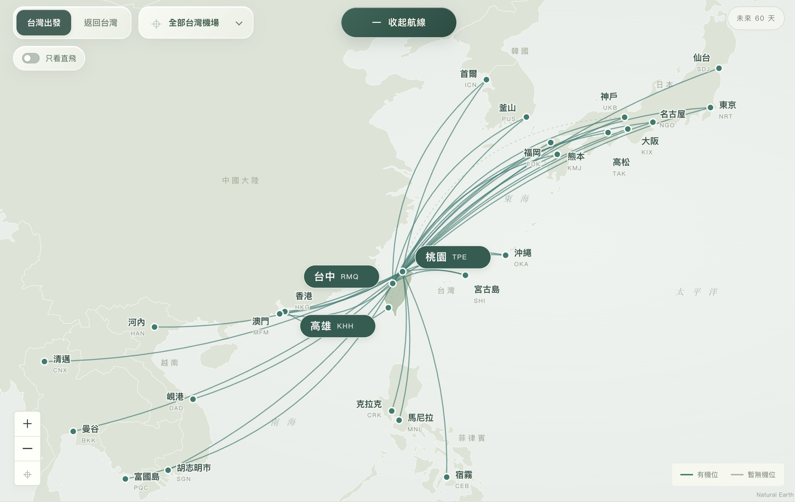

# Four Business Seats, Taipei to Tokyo, in Under Five Minutes

**Date:** 2026-10-16

---

With this website, in under five minutes
I had business-class seats lined up for next summer
Taipei to Tokyo, four of us flying out together

On the dates below that I found this time, every flight has 4 or more business-class seats

✈️ Outbound｜Taipei → Tokyo
July 2027: 21, 25, 26
August 2027: 4, 9, 10, 11, 12, 23, 24, 27, 28, 30, 31

✈️ Return｜Tokyo → Taipei
July 2027: 29
August 2027: 17, 18, 19, 26, 27, 30, 31

In total, 18 outbound flights and 10 return flights
STARLUX business class, 15,000 points one way

The progress of AI really moves me
Maintaining a website is genuinely easy now
One Grok bot runs a scheduled job that imports new data every day
another Grok bot hooks into Stripe to handle payments

The old me only knew how to invest
which was honestly pretty boring
Now, with AI's help, I'm stepping into new fields
and taking part in the process has given me a better grasp of where stocks sit in the ecosystem
Cloudflare and Stripe, for example🤣

The website's bugs are mostly fixed now
From here on, each route can be subscribed to separately
one dollar per round-trip route
The current six-month $3 Pro plan will end within 48 hours
Thank you, members, for your feedback

If you run into any problem with the website, feel free to DM me directly

## Replies

> Reader: What about short videos!

> Reader: Once I'm financially free I'll come to the group to collect from Master Blade

🤣🤣ok
I deliberately kept the features very narrow; just use it when you actually need Alaska

> Reader: What does "points" mean?

Alaska Airlines points
Taiwan really is a great base
there are tons of good routes nearby, from Northeast Asia to Southeast Asia
and they sit right in a very nice points-price range

> Reader: Glad I'm already a founding member!

---

Original post: https://www.threads.com/@edgeless.blade/post/DejbfZ0jqrn
