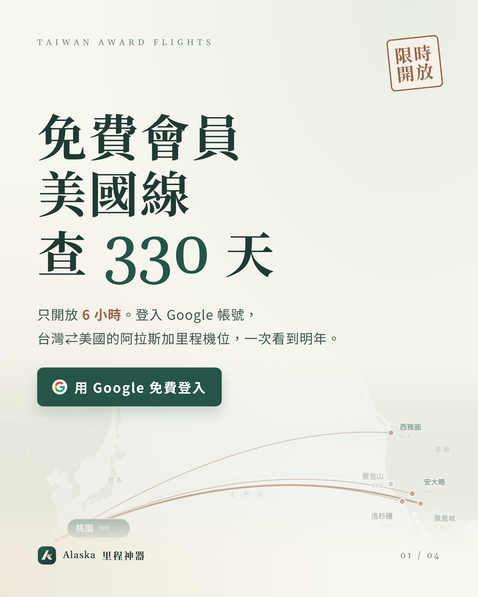
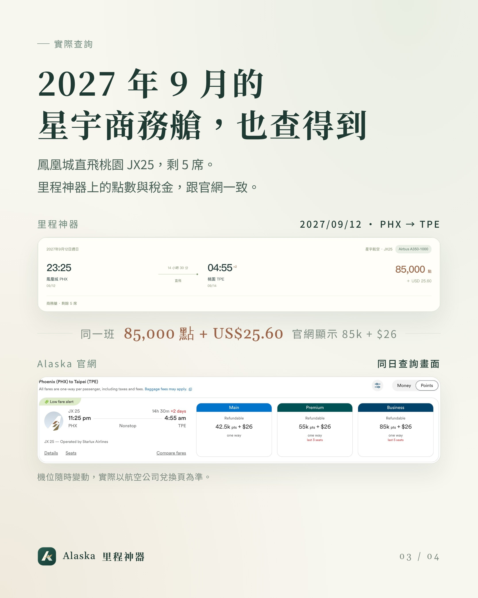
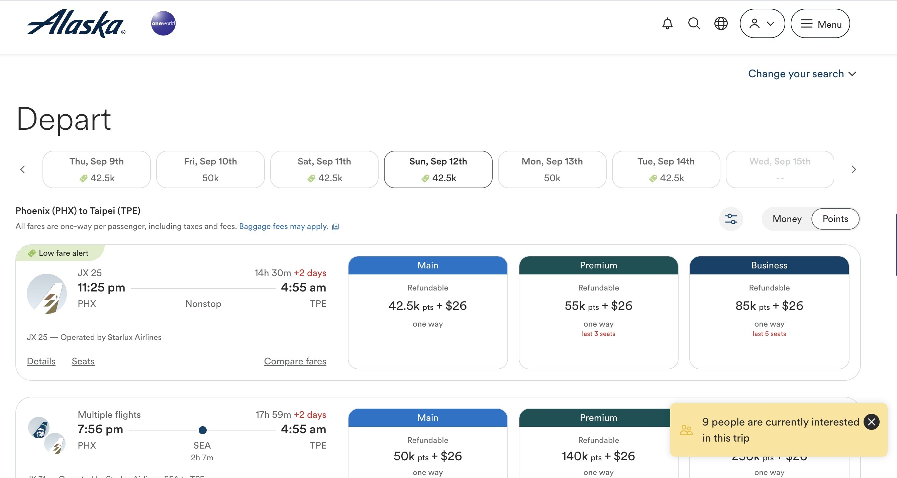

# Alaska Award Finder: US Routes Free for 6 Hours

**Date:** 2026-10-18

---

France is rioting, so going there now is a bit risky
Fine, let's head the other way and fly to the US
(Truth is, Taiwan ⇄ Europe has no award seats released at all)

The Alaska award finder, for 6 hours only
Free members can search right away
Taiwan ⇄ US award seats for the next 330 days
Airports include:
Seattle SEA
San Francisco SFO
Los Angeles LAX
Ontario ONT
Phoenix PHX

Economy: 37,500–42,500 points
Business: 75,000–85,000 points
I flipped all the way to next September
STARLUX JX25, Phoenix nonstop to Taoyuan, still has 5 business seats left
Normally, dates this far out are visible to paid members only
Go tell your friends who still can't find tickets

PS. The official site really does still have five business seats out there
Nine people are looking at it right now, so if you ticket too late and miss out, not my problem🤣

miles.edgelessblade.com

---

Original posts:
- Part 1: https://www.threads.com/@edgeless.blade/post/DeodrJjDiIR
- Part 2: https://www.threads.com/@edgeless.blade/post/DeofP1wDq_w
