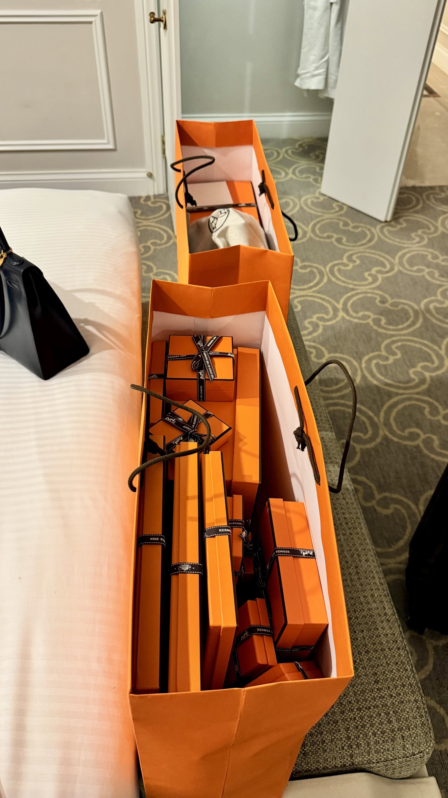

# Want to Join the Hermès Stable? First Understand Its Blind-Box Machine

**Date:** 2026-05-16

---

Want to join the Hermès stable? First you have to understand the core mechanism behind Hermès

At heart, Hermès isn't just selling bags
It's selling a meticulously engineered "blind-box mechanism"

The whole store is one big luxury blind box
Before you walk in, you don't know whether there'll be anything in stock today
you don't know what color you'll get
you don't know whether you'll suddenly be "offered" the bag you've been dreaming of for ages

So the moment the SA finally brings that bag out, your brain releases an instant rush of "I finally hit the jackpot"

Once you slip into "jackpot mode"
the price stops mattering
the pre-spend ratio starts to seem reasonable
the SA doesn't need to convince you; you've already convinced yourself

Blind-box systems are nothing new, any merchant can design one. But holding the line on price over the long haul is Hermès's real competitive edge

## Replies

> Reader: Once you're close enough with your SA, they'll text you directly about bags you might like. If you like it, you go to the store, buy your pre-spend items and pick up the bag

Spend first
then wait for the bag
At heart you're still waiting for the SA to one day draw your number and open your blind box

> Reader: Right, once you've spent up to a certain level you get close with the SA, and only when you're close enough does jackpot mode switch on

> Reader: I've come to think it's basically a slot machine. It lights up the very same dopamine circuits in your brain

Pretty much, pretty much

> Reader: Just two weeks ago I got one with no pre-spend at all, and only when my girlfriend told me did I realize the sales associate had been dropping hints🫠

> Reader: The economy's bad👎 so maybe they can go easier on the pre-spend

> Reader: So even Big Bro keeps horses

Pretty much beat the game
but I'm sitting out the playoffs

> Reader: True, the unboxing really is a lot of fun

Store-hopping really is something to look forward to

> Reader: Run through the process once and you'll get the hang of it👍
> Big Bro, wait till I go to Japan🇯🇵 this year
> then I'll be sliding into your DMs, my online consultant❤️

> Reader: Another transliteration of this brand is "Hē-mì-sǐ", "drink honey and die"...😄😄😄

---

Original post: https://www.threads.com/@edgeless.blade/post/DYY99HMkfJn
