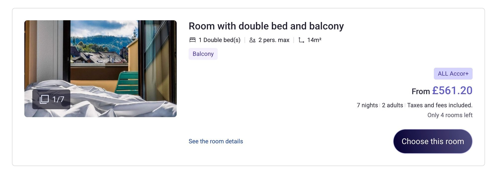
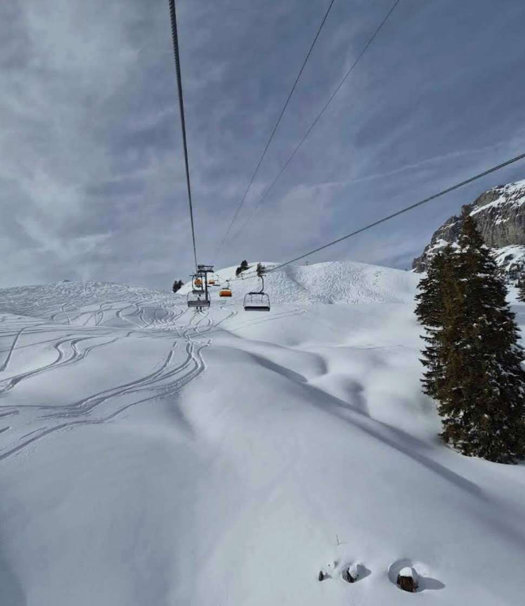
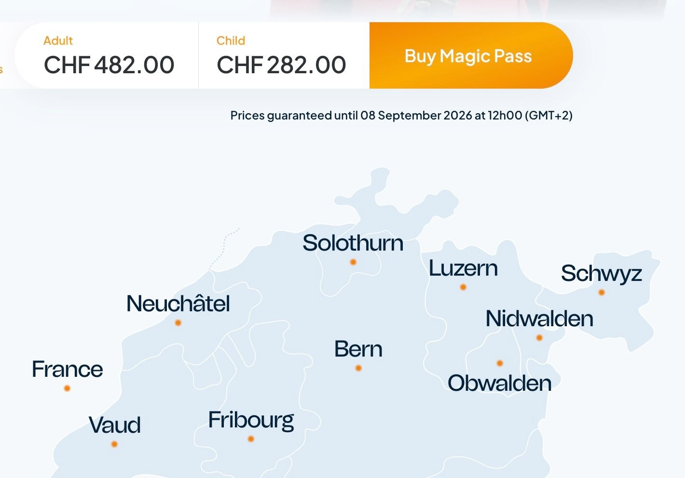
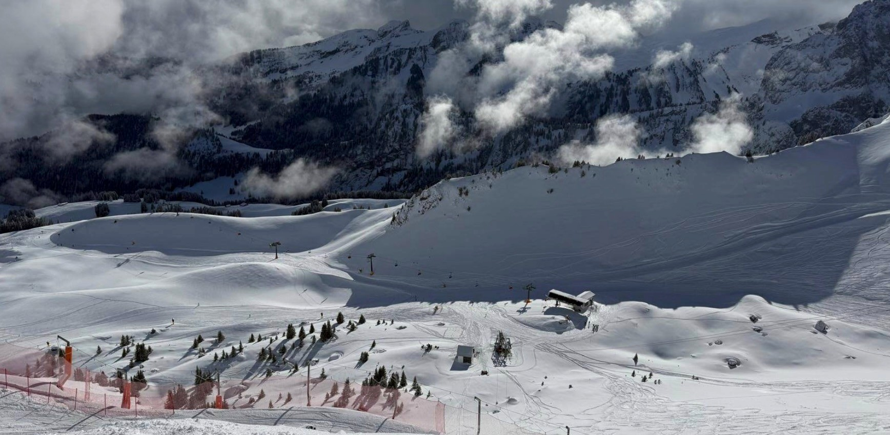
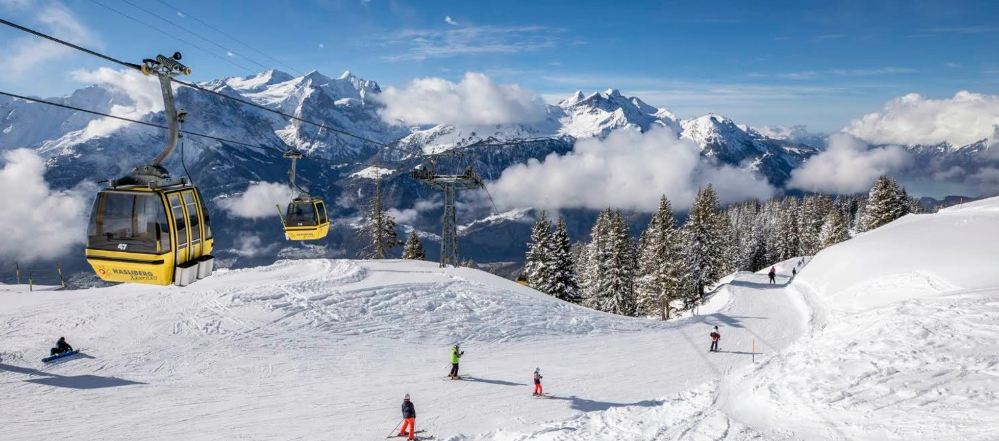
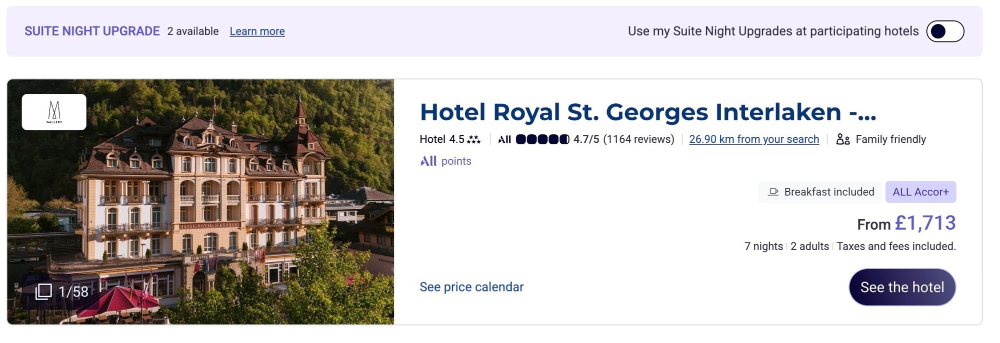

# A Month of Skiing in Europe: Buy the Swiss Magic Pass Now

**Date:** 2026-05-31

---

If you're also planning
to spend a month skiing in Europe
over the winter break in the 26-27 season

you should buy this god-tier pass right now:
the Swiss Magic Pass

Right now an adult pass costs only CHF 482 for the whole year (the price slowly goes up over time)
That's about what a one-week lift ticket alone costs in Niseko, Japan, yet it lets you ski more than 100 resorts across Switzerland, France and Italy

I've sorted out the lodging for you too:
the prices aren't scary at all
If you go with something like ibis
a week's stay runs roughly €500-600
It's pretty much the European version of Toyoko Inn / APA: clean, cheap, and a good base for a self-drive ski trip

Here are some hotel and resort pairings
in case you're interested
ibis Sion + Anzère
A central base in Valais, about a 20-minute drive to Anzère. The resort gets plenty of sun and wide-open views, and it's easy to ski the other Magic Pass resorts nearby too

ibis Bulle La Gruyère + Gstaad / Rougemont
The top value-for-money pick
Staying in Bulle is a lot cheaper than staying in Gstaad, and it's about a 40-minute drive into the Gstaad ski area: big, lots of restaurants, plenty of runs to choose from

**Part 2**

ibis Annecy Centre Vieille Ville + Le Grand-Bornand
Stay in Annecy, a small French lakeside town with everything you need close at hand; the resort is about a 40-minute drive away
Le Grand-Bornand is a classic Alpine-village resort, good for intermediate skiing and a real holiday feel

A more upscale hotel pairing
Hotel Royal St.Georges Interlaken - MGallery + Meiringen-Hasliberg
If you want somewhere a bit fancier, pick this one
About €1,700 for a week over the winter break, paired with 60 km of pistes in the Bernese Oberland; it should make for a week of beautiful memories
.
Magic Pass covers a huge number of resorts
and Europe has a huge number of hotel chains
so you can always piece together a plan that suits you
but remember to buy the season pass early

## Replies

> Reader: Saving this

> Reader: Tesla's mooning

> Reader: Nice!

Once you lay it all out, it's not that expensive
the Magic Pass price is just too sweet

---

Original posts:
- Part 1: https://www.threads.com/@edgeless.blade/post/DY_FruCAT2g
- Part 2: https://www.threads.com/@edgeless.blade/post/DY_FtOWAcZc
