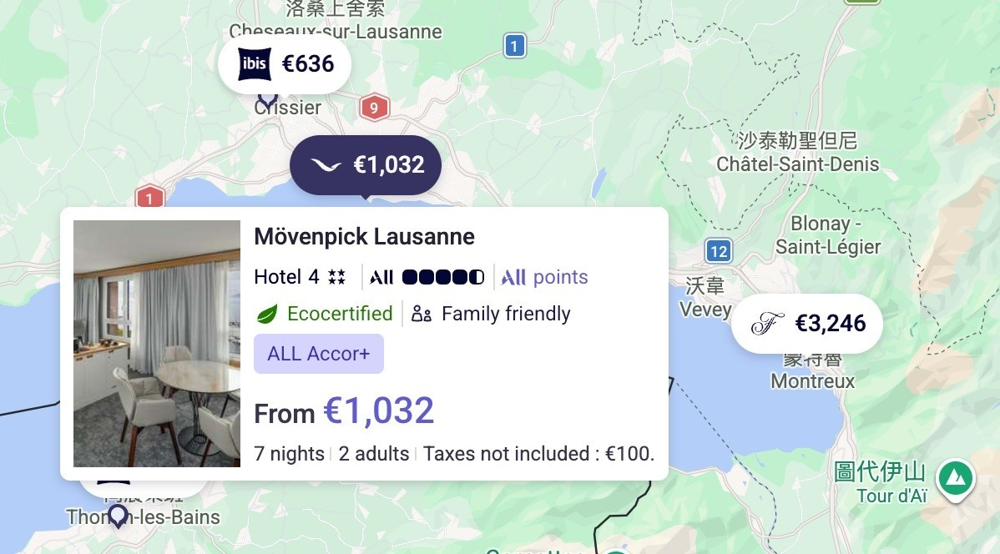
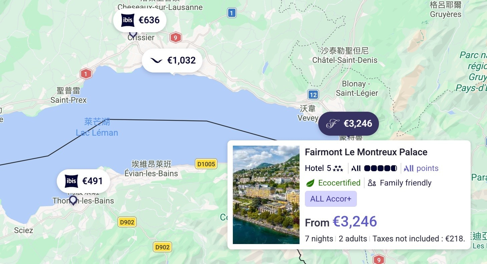
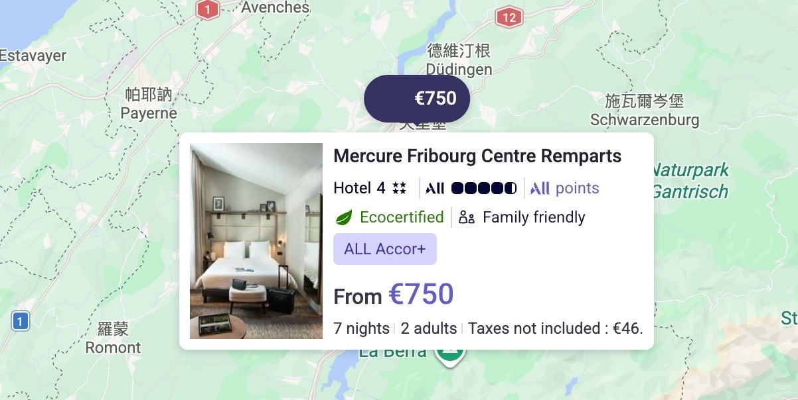
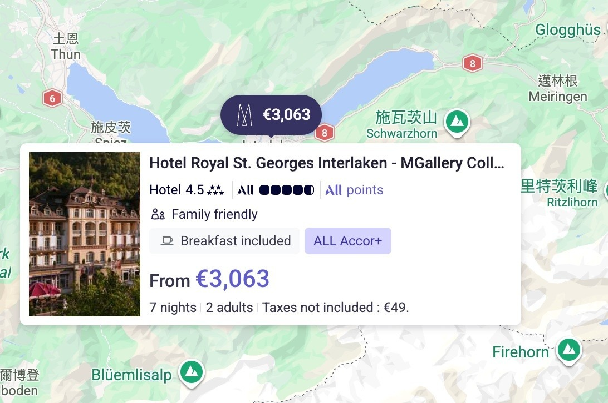
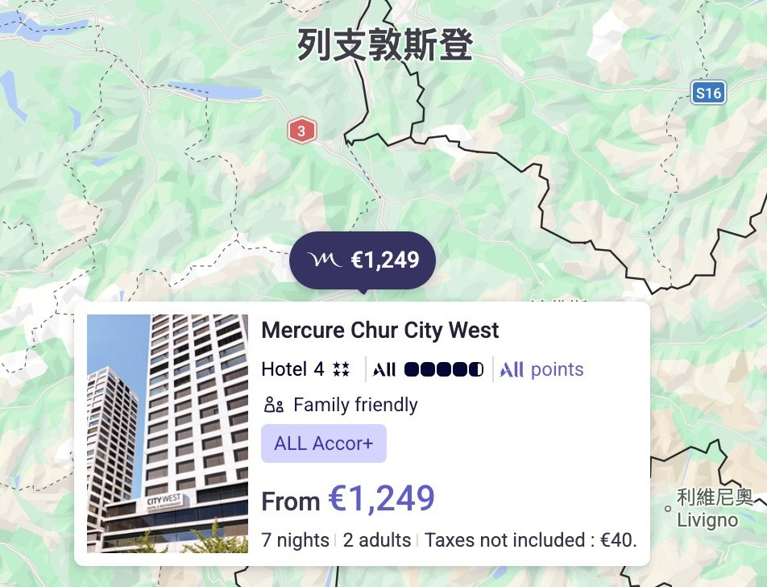
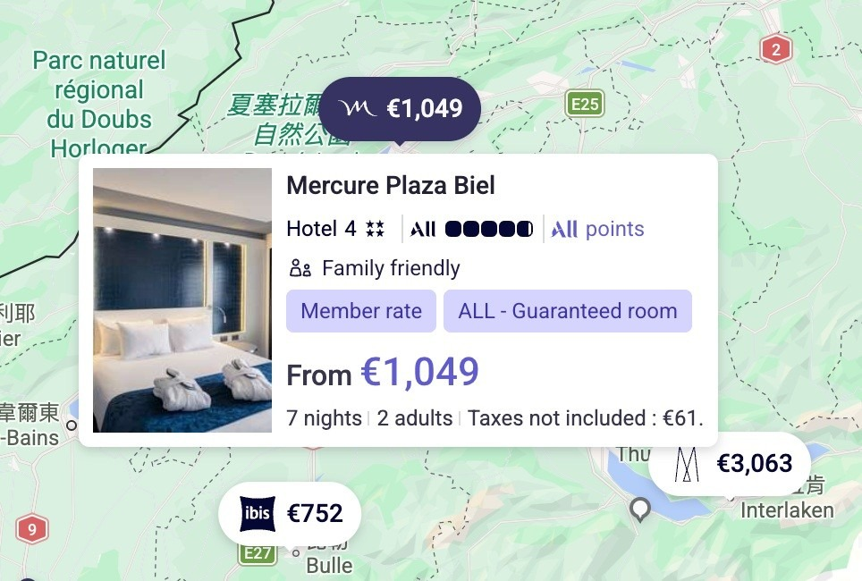

# The Earlier You Book Hotels, the Cheaper They Are

**Date:** 2026-06-09

---

The earlier you book hotels, the cheaper they are
I've found them for you
A week over the Christmas holidays (12/23-12/30)
most of them come to only a little over NT$30,000 in total
for a week's holiday in Switzerland
all pretty decent hotels
the cheapest even comes in under 30,000 in total

## Replies

> Reader: Tesla's mooning

Then I'll have to upgrade my hotel

---

Original post: https://www.threads.com/@edgeless.blade/post/DZW4pvGESXj
