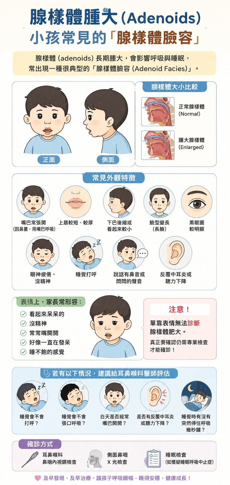
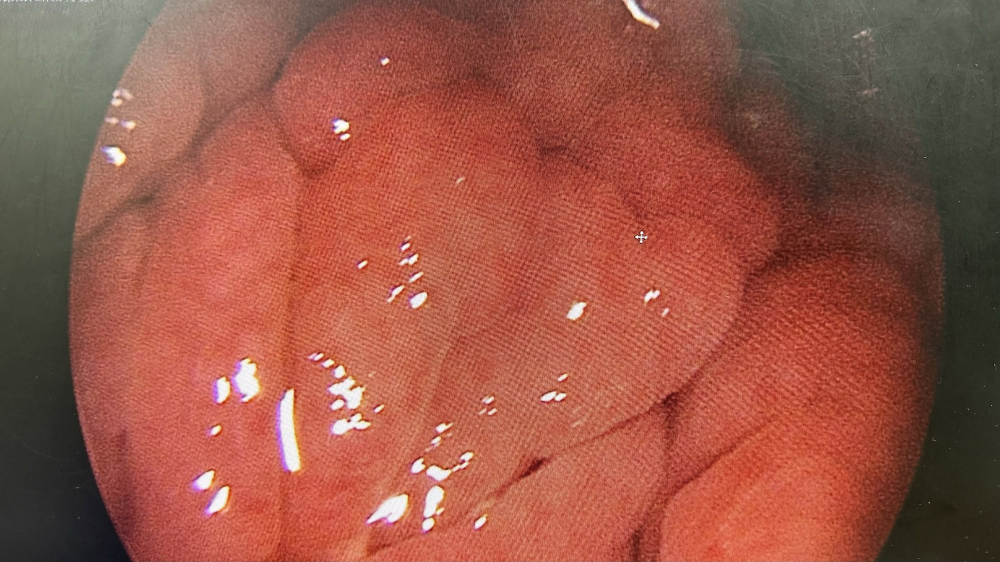

# I Thought It Was Just Mildly Enlarged Adenoids

**Date:** 2026-06-14

---

I thought it was just mildly enlarged adenoids
making my kid breathe through the mouth now and then during sleep
Only once they went in for surgery did they find out
it was huge
completely blocking the back of the nasal passage
Thank you to my ENT doctor
The billing staff were really professional too
and reminded me: if a primary schooler has surgery, remember to claim on the student insurance
I checked, and it actually pays out 50,000
With summer vacation just around the corner
parents, if your child shows any of the following signs, take them to a hospital ENT doctor
.
Common outward signs include:
* Mouth often hanging open (a blocked nose means breathing through the mouth)
* A shorter, thicker upper lip
* A receding or small-looking chin
* A lengthening face (long face)
* More noticeable dark circles
* Tired, listless eyes
* Snoring in sleep
* A nasal or muffled-sounding voice
.
As for expression, parents often describe it as:
* Looking a bit dazed
* Low on energy
* Mouth often hanging open
* Seeming to space out all the time
* Looking like they never get enough sleep

## Replies

> Reader: That sounds exactly like nasal allergy symptoms

It actually was
We dealt with everything that needed dealing with

> Reader: May I ask where you were seen?

I believe any hospital's ENT department can handle it well. You can also check the hospital's doctor profile pages beforehand and look for a doctor whose specialties show they handle this area more often

---

Original post: https://www.threads.com/@edgeless.blade/post/DZkHp0xEYYv
