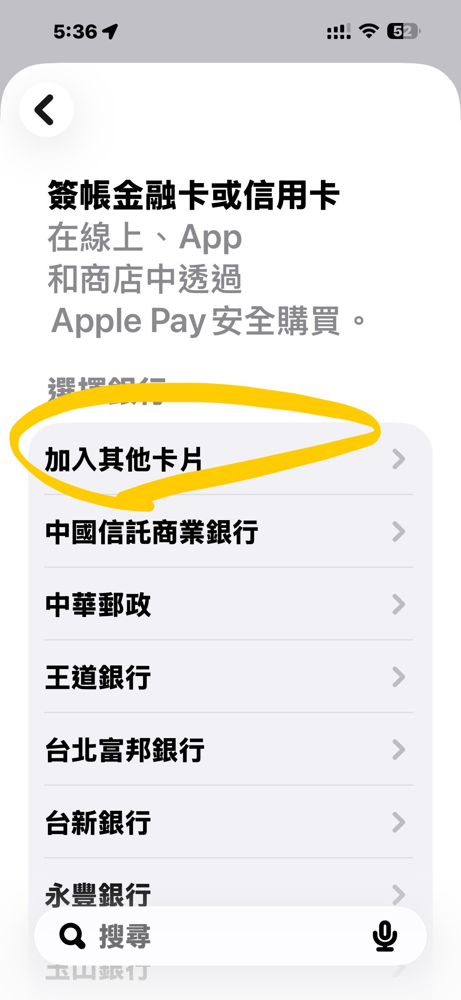
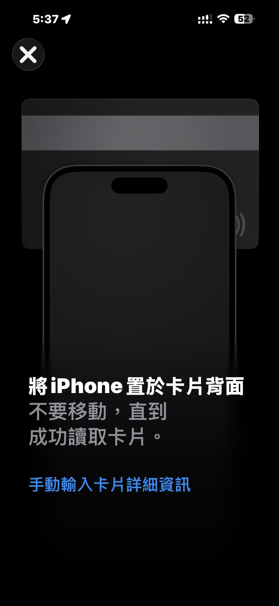

# Discovering Fire Series: Adding Cards to Apple Pay

**Date:** 2026-06-20

---

Discovering Fire series

When I add a credit card to Apple Pay
I usually just pick the bank from the list
and then Wallet makes you import the card from that bank's own app
It's clunky at the best of times
but since it's once in a blue moon, I put up with it

This time I was doing it for my wife
and hit a Cathay United supplementary card that doesn't even show up in the Cathay United app, so there was no way to import it. Totally dumbfounded

So I just skipped the bank, went with add another card, held the physical card up to the phone, and three seconds later it was all set up ==
Give me back all the time I wasted on those banks' terrible app UIs

## Replies

> Reader: So that's how you do it😂

Such a handy feature
and they don't even promote it
Listing a pile of bank apps instead is just maddening

> Reader: Totally, same here

> Reader: Teacher, I want a supplementary card too

Apply for your own

> Reader: So that's how!!!

Let's discover fire together

> Reader: That said, for E.SUN at least
> I'd recommend adding it through the credit card app's guided flow
> so you skip the extra SMS verification
> and don't have to enter any more info
> There's an icon at the top of the app's home screen just for adding to Wallet / Pay
> works for both Apple Pay and Google Wallet

> Reader: Leaving this here for friends: the fix for the idiotic card-adding system.

---

Original post: https://www.threads.com/@edgeless.blade/post/DZzZ0SnEaaK
