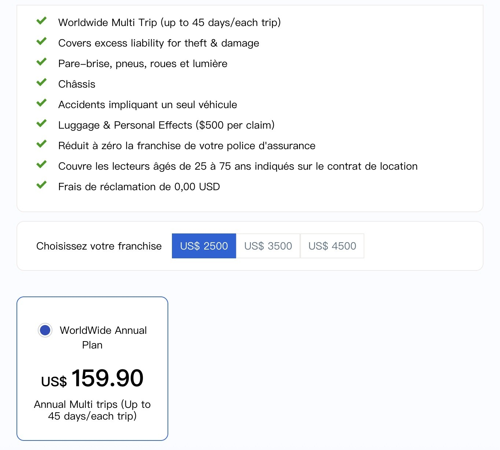
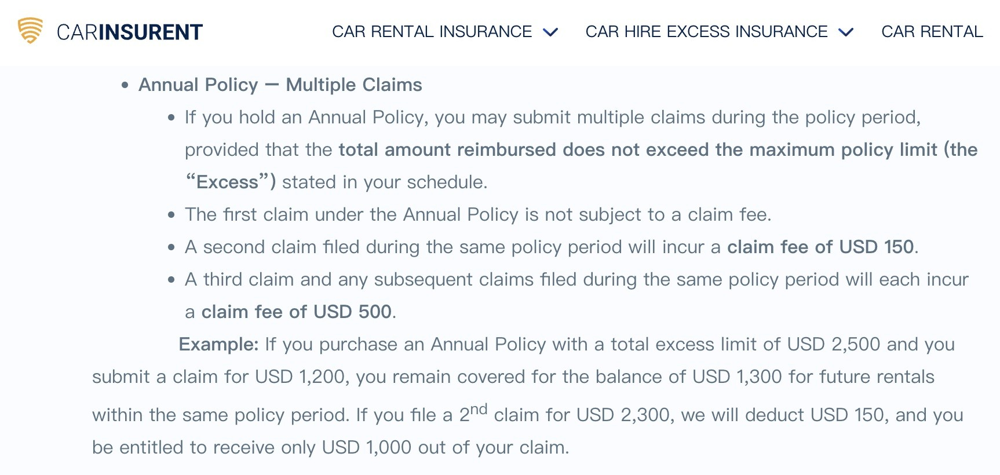

# If You Rent Cars Abroad Several Times a Year

**Date:** 2026-07-10

---

If you also rent cars abroad several times a year
here's an insurance I've been using a lot lately
These days when I rent a car abroad, I usually don't add any extra cover, just the basic CDW.
Carinsurent's excess insurance covers the major countries worldwide for a full year
for just US$159
(the ones not covered are usually unstable, turbulent countries)

It looks like a great deal, but there are still limits
A single rental can't exceed 45 days
The first claim has no handling fee
The second claim deducts a US$150 handling fee

So it really suits people who rent cars abroad often and rarely crash
No crash the first time, keep using it the second; no crash the second time, keep using it the third.
And if you do crash? After the first claim, maybe consider buying a new policy😂

---

Original post: https://www.threads.com/@edgeless.blade/post/DamwySbjnfg
