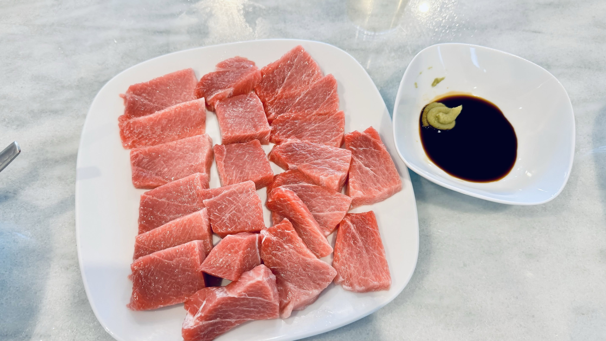
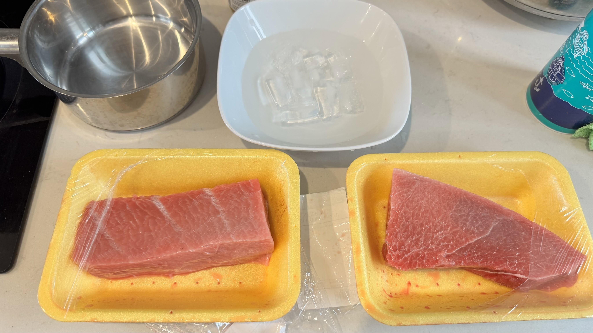
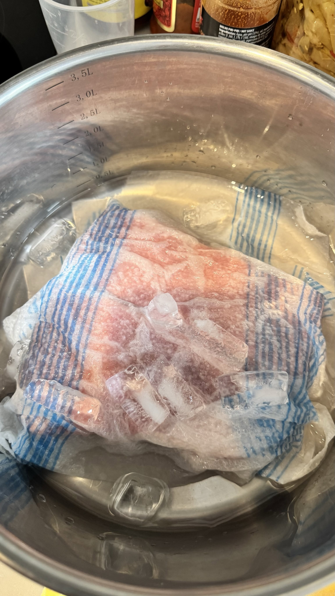
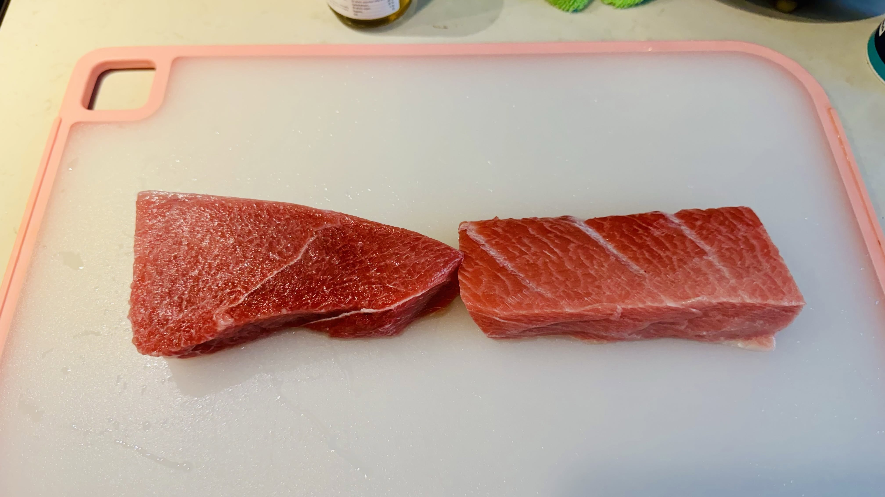

# Every Time I'm Abroad, I Crave Sashimi

**Date:** 2026-07-29

---

Every time I go abroad, unless it's to Japan
after a while
I get wild cravings for sashimi
Today I came across same-day tuna belly that had been kept really well
Snapped it up, paid in full
"High-risk behavior, do not try this at home"

## Replies

> Reader: Just had my fill

If I were in Japan I'd hit the supermarket every day too
Everything in these photos is supermarket stuff

> Reader: Now I'm hungry

> Reader: I'd probably be done after three slices

High-risk platter

> Reader: Bro, where do you buy this?

Happened to pass by and spotted a catch with an unbroken cold chain
Snapped it up, paid in full
Personally, I think anything outside Japan
isn't worth trying

---

Original post: https://www.threads.com/@edgeless.blade/post/DbXaAzXiCG-
