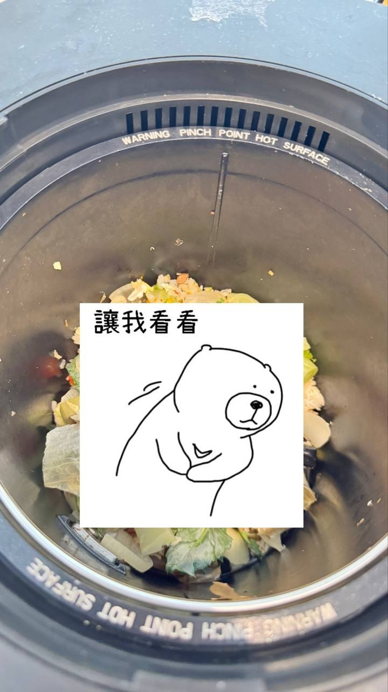
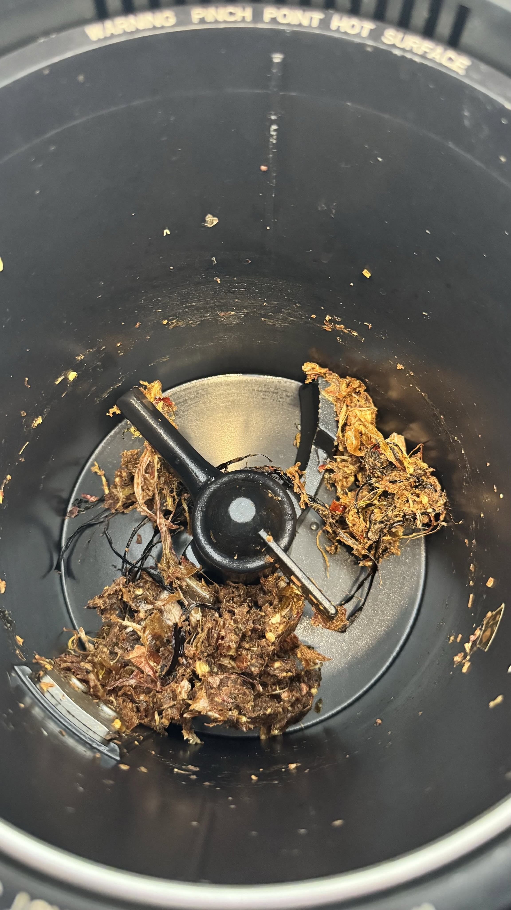
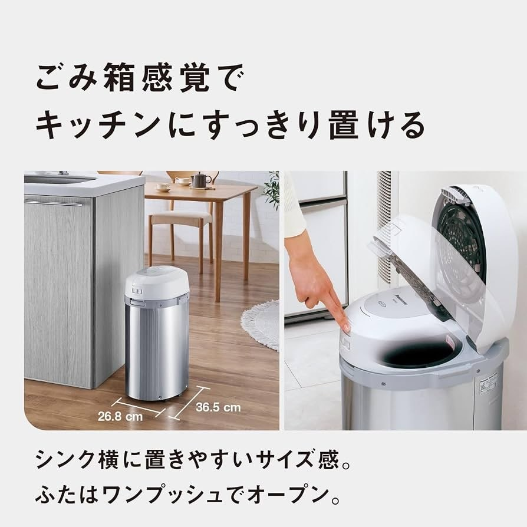

# Already Have a Dryer, a Dishwasher and a Robot Vacuum? Get a Food Waste Processor

**Date:** 2026-09-09

---

If you already have a clothes dryer, a dishwasher and a robot vacuum
do consider a food waste processor
A must-have machine for a happy marriage
The volume reduction is astonishing
And it doesn't smell at all
Even if your building has a refrigerated trash room
I'll always choose the food waste processor

As for the model I recommend most
It's the Panasonic MS-N53, every time
Everything else is too small
Don't bother with resellers in Taiwan, they're all a rip-off
Just grab one on your next trip to Japan

## Replies

> Reader: Keeping a goat works too
> It doubles as a paper shredder

> Reader: Put rice in and it spits out mochi

If it's clean the first time
pure rice flour
If the walls already have an oily film
probably scallion-pancake-flavored mochi

> Reader: Sounds like you've got plenty of experience..

I use it every day
Never having to touch wet food scraps is bliss

> Reader: We use ours every day too
> But by "plenty of experience" I meant you make mochi a lot😂

> Reader: An "iron stomach" disposer under the sink is even handier～～～

The drain pipe has to be a certain size
New detached houses have a better shot
and they have to be self-built
Probably better suited to how things are done abroad
If you can use one, it is more convenient

> Reader: Question: afterward, does the residue go out as food waste or general trash?

> Reader: Adding it to my must-buy list

Legit, highly recommend

---

Original post: https://www.threads.com/@edgeless.blade/post/DdEHKDojsFj
