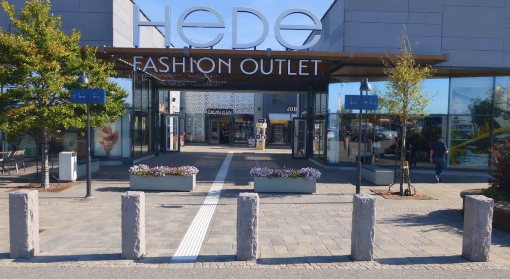
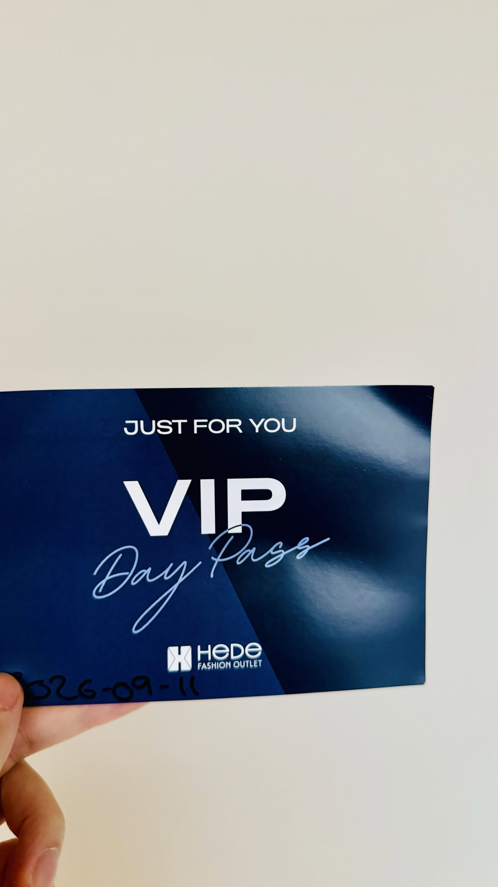
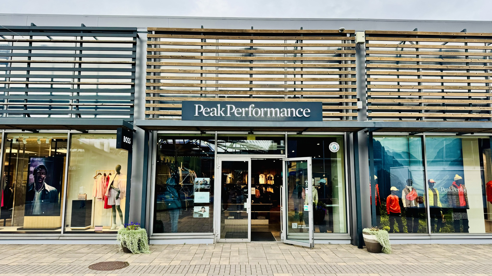
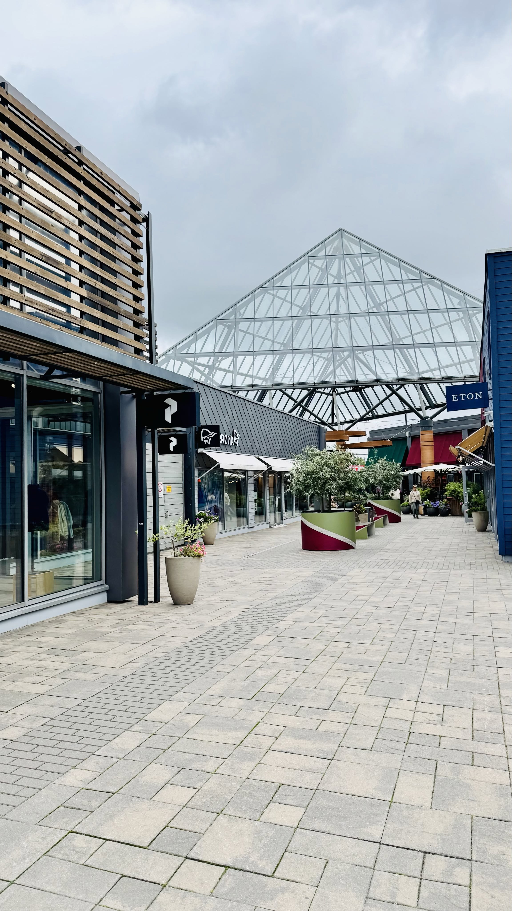
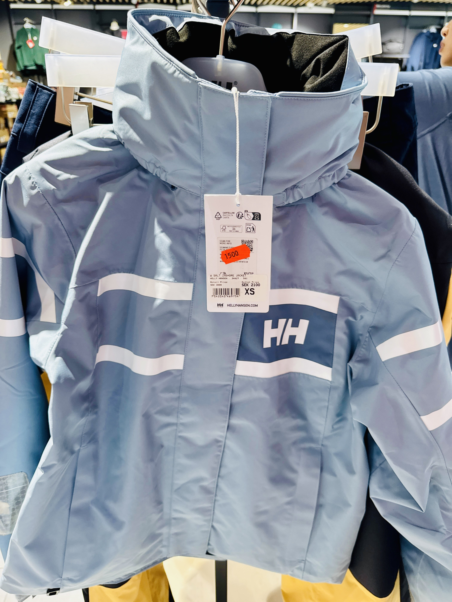
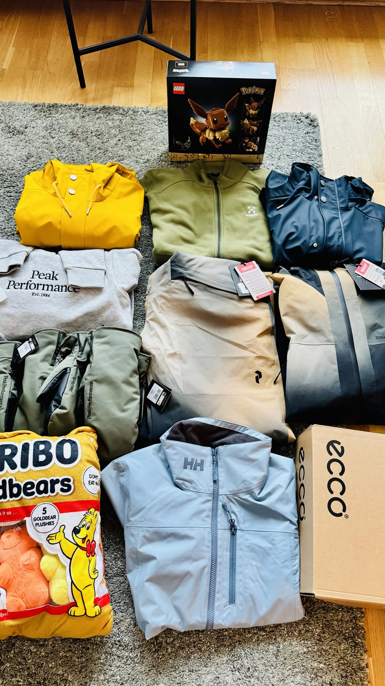
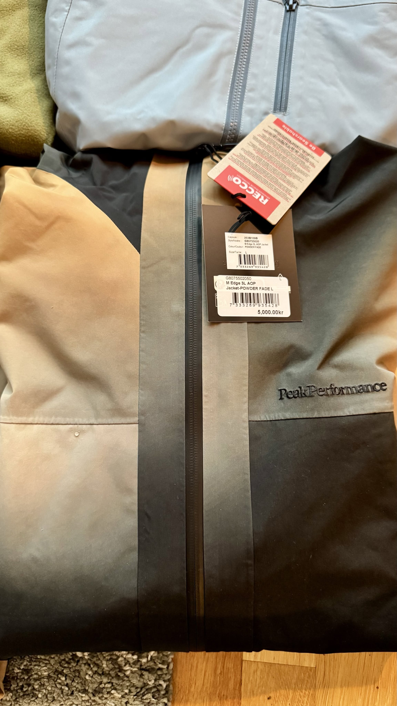

# Hede Fashion Outlet: Discounts So Deep They Break Bones

**Date:** 2026-09-12

---

Discounts so deep they're literally bone-breaking
Buying outdoor brands in the Nordics is just too good a deal
Anyone coming to Sweden absolutely has to set aside a day for this Hede Fashion Outlet

Norrøna, Peak Performance, Haglöfs (the stick-figure one), Helly Hansen: the big-name Nordic outdoor brands are all here
The discounts are insane
Once you're in, there's no getting out without spending the whole day

Everyone, if you spot this brochure at the airport, be sure to grab one
Once you're inside the outlet, go to the service desk and you can swap it for a VIP card
Most items get an extra 10% off
Stack that with the 19% tax refund
And once you register as a Hede Outlet member, every purchase also earns you 5% back in points

Let's work out just how bone-breaking this is🤣
Take one item I bought today as an example
Peak Performance Edge 3L AOP Jacket
List price: 5,000 SEK
After the store's opening 30% off: 3,500 SEK
After VIP 10%: 3,150 SEK
Actual cost after tax refund: 2,551.50 SEK
5% member points: 157.50 SEK
Final effective cost: about 2,394 SEK
Roughly NT$7,800
Bone-breaking, these discounts are truly bone-breaking

**Part 2**

Finally, the member points
On every purchase they can cover up to 25% of the amount
The pity is, once you choose to redeem points, you can't use the VIP 10%
That VIP 10% is just too tempting, and it doesn't eat into the points you've built up
All the points from today's shopping are staying in my account
Already over 600 just like that
I'll figure it out later
Maybe if I ever really need something, I'll make another trip🤣

## Replies

> Reader: Jealous

---

Original posts:
- Part 1: https://www.threads.com/@edgeless.blade/post/DdLbLjbDq-s
- Part 2: https://www.threads.com/@edgeless.blade/post/DdLbLecjjxe
