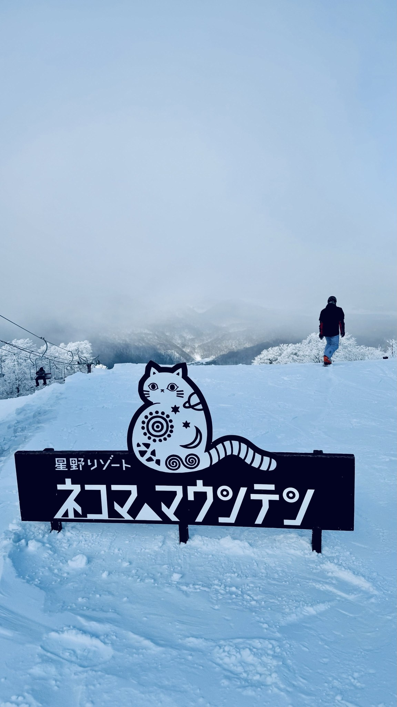
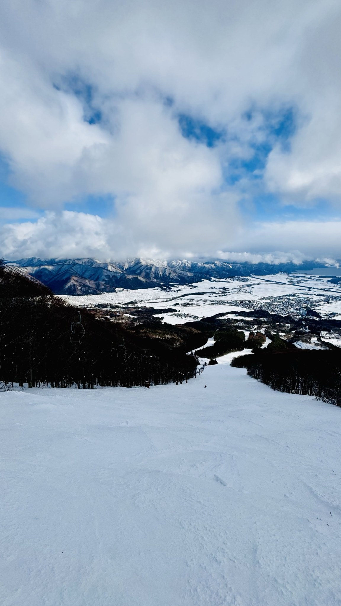
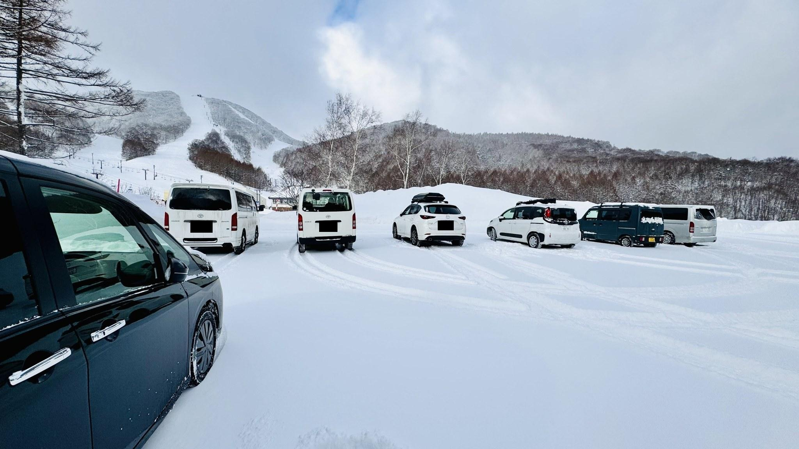
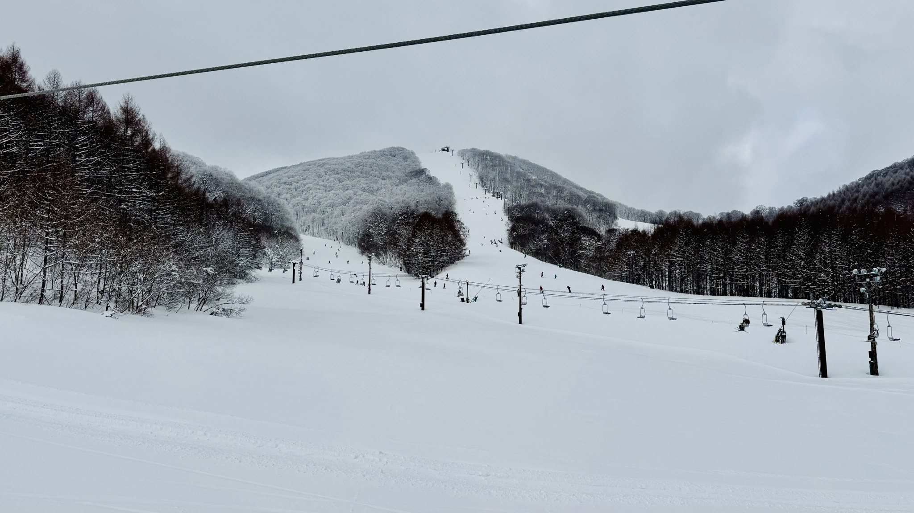

# Inawashiro and Nekoma: Two Weeks of Skiing, Straight Up

**Date:** 2026-09-19

---

Lately I've started seeing affiliate links for lodging at Nekoma ski resort, so I'll leave it at that🤣
Inawashiro and Nekoma
I happened to spend two weeks at both
So here are my straight-up impressions
Nekoma: great terrain, excellent snow, super powdery
Inawashiro: weekday skiing is free
(that's just too imba)
PS Experts, go in through Nekoma's North entrance
Fewer people, easy parking
One lift ride takes you to the summit of North Nekoma
Take the summit connector lift once more
and you're right at the summit of South Nekoma
where you can start tearing up the powder off South Nekoma's summit straight away
The downside is getting back from North Nekoma's summit
If the red run is closed
all that's left is one ungroomed black run🤣🤣
So if you can't force your way down a black run
don't go in through Nekoma North

## Replies

> Reader: Total newbie here, heading to Inawashiro and Nekoma at the end of this year or early next year. Senpai, any suggestions for spots at these two resorts where I can just ski happily at my own pace?

> Reader: Question, senpai: is South Nekoma the same as Hoshino's Bandai?

Don't call me senpai
just a fellow snow buddy
Yes
Hoshino's hotel
is at Bandai, by the South entrance
ski in & out

> Reader: I'm also thinking of Nekoma or Inawashiro in January of the 26/27 season. Any lodging recommendations?

If you're driving, there are tons of options
just go for good value
Plus Inawashiro is one of the less densely populated parts of Japan
so driving is a pleasure👍
Wow, I saw your snowboarding, you're really good

> Reader: I happen to be going to Inawashiro next March!

Four resorts in a week is just about right🤣

and there really are hardly any people

---

Original post: https://www.threads.com/@edgeless.blade/post/DdeQCPKiOFc
