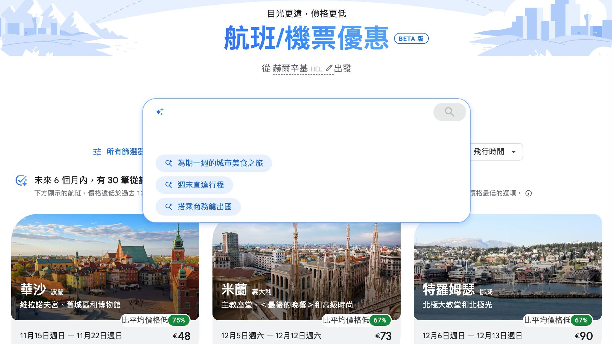
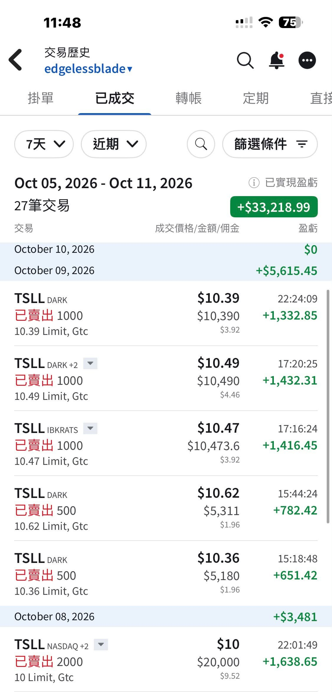

# I Meant to Book One Ticket, and Ended Up Planning the Whole Year

**Date:** 2026-10-11

---

This week my mind really wasn't on investing
It all started because the release dates for long-haul award seats were piling on the pressure, so I began booking

Some tickets you have to watch 360 days before departure, like EVA Air; others 330 days out, like Alaska

Two basic but god-tier sites I recommend
[matrix.itasoftware.com/search](https://matrix.itasoftware.com/search)
and Google Flights, which now has AI built in
It plans itineraries fast and well

I only meant to book one ticket, and by the time I came to my senses, nearly the whole year's holidays were planned😂
Careful, if the planning goes too smoothly
your calendar ends up looking like this
This month: Montenegro
December: Switzerland, on a season ski pass
February: skiing in Poland
April: the Dolomites, still can't decide between skiing and hiking
May: nothing planned yet, my wallet's only breather so far
June: the UK
August: the Netherlands

With a schedule like that, the spending still stings a little
So I'll just have to sell some stock to help cover the household budget🫠

The most exhausting part isn't actually hitting "Pay"
It's that every trip is one link locked into the next:
the flights have to fit the holidays, the holidays have to fit the lodging, and skiing also has to fit the season and the season pass

## Replies

> Reader: Rich

Richie

> Reader: Bro, are you going skiing in Zakopane, Poland?

I was originally going to drive to Špindlerův Mlýn in Czechia, then pulled a sudden U-turn to Zieleniec
Never been to either anyway
I'll knock out a filler post with my impressions later

> Reader: April collision! Don't let me catch you in the Domilotes

I bought camouflage

> Reader: What I envy is how free and flexible your time is😍

> Reader: Looking forward to your Montenegro travelogue

---

Original post: https://www.threads.com/@edgeless.blade/post/DeWcQepjtCW
