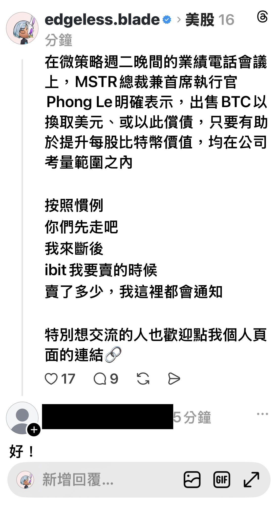

# MSTR May Sell BTC: You Go On, I'll Cover the Retreat

**Date:** 2026-05-06

---

On MicroStrategy's earnings call Tuesday evening, MSTR President and CEO Phong Le made it clear that selling BTC for dollars, or using it to pay down debt, is on the table as long as it helps lift bitcoin per share

As usual
you all go on ahead
I'll cover the retreat
Whenever I sell IBIT
and however much I sell, I'll announce it here

Anyone who especially wants to talk is welcome to tap the link on my profile page🔗

**Part 2**

This one's automated shapeshifting routine seems to have glitched

## Replies

> Reader: Going on the offensive with BITX?

All yours

> Reader: I'm the poor soul who sold IBIT covered calls at 45 and 46

Bank it while it's hot

> Reader: Next run, keep buying, keep CC-ing, CC Lemon

> Reader: BTC doesn't seem to be reacting much
> I'll walk with you to the end
> My Tesla's pumping

Let's watch the open

> Reader: Tesla's pumping!!

LOL
This time my heartstrings actually twitched

> Reader: Ba-dum

> Reader: I suspect Strategy is using all this talk of selling BTC to lure retail into shorting, piling up more short fuel to push the price higher. BTC just climbed to 81K and funding rates keep staying negative, all fuel courtesy of the shorts. As long as funding doesn't turn positive, the shorts won't die and the price won't stop🤭

Maybe the company was just meeting its disclosure obligations
but the media insists on spinning it like this
maybe with ulterior motives

> Reader: Indeed😆

> Reader: Uh-oh, are we in trouble?

> Reader: Would I lose if I just bought MSTU🥹

---

Original post: https://www.threads.com/@edgeless.blade/post/DX-3wTWETG3
