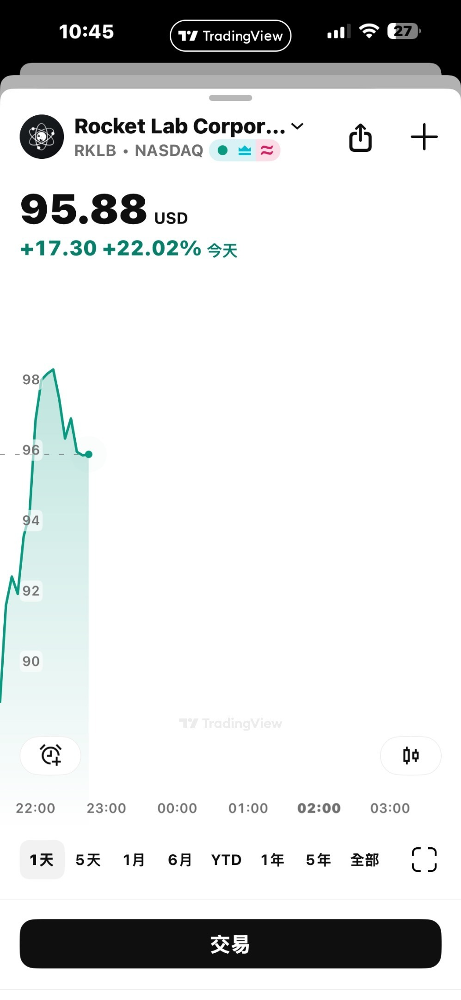

# If the US Announced Aliens Exist, What Would You Pump?

**Date:** 2026-05-08

---

If the US announced that aliens exist
which stock theme would you pump?

**Part 2**

Quite a few of you shouted RKLB
and it actually went up
You guys are kinda savage at picking stocks

## Replies

> Reader: "It is like that, but it's not like that" so funny 😆

> Reader: Space stocks

A space-sector ETF

> Reader: According to the prophecy in The Three-Body Problem, resources will be concentrated in the military and aerospace industries

I believe in Three-Body

> Reader: JPP-KY

Is that one free to watch?

> Reader: TSLA
> It's already climbing in premarket

Really, this one 🤣?

> Reader: Has it already had its run? I'm getting out first, too dangerous otherwise

> Reader: Power, surely? Don't spaceships need electricity?

The popular picks really are the usual suspects

---

Original posts:
- Part 1: https://www.threads.com/@edgeless.blade/post/DYEmPHHka6R
- Part 2: https://www.threads.com/@edgeless.blade/post/DYFN5uOEUsL
