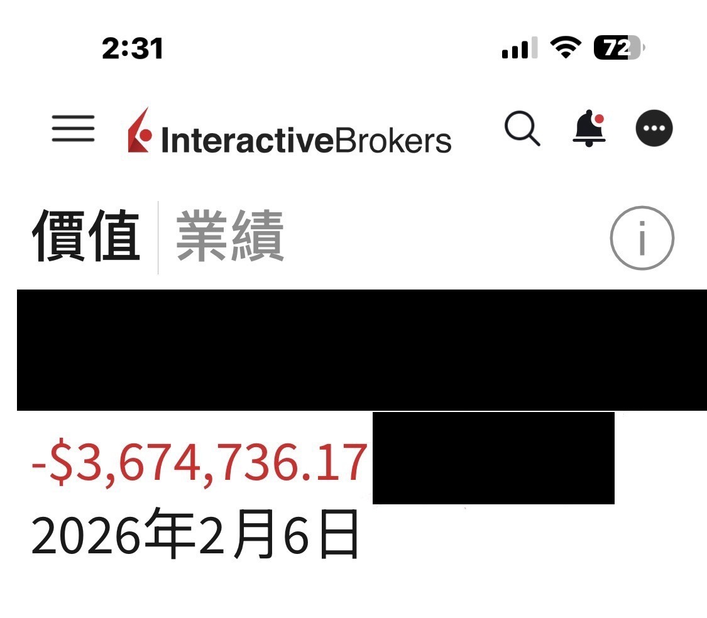
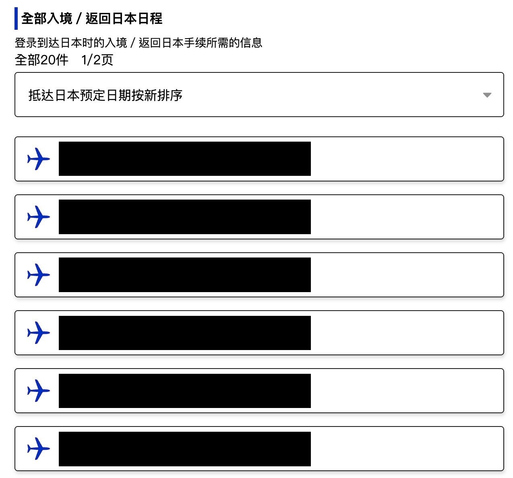

# One Answer for Everyone: US Dollars

**Date:** 2026-05-22

---

One answer for everyone: US dollars
As for the sentimental stuff
let's not say too much
I honestly don't know how I've held on this far this year

**Part 2**

Any links below are, without exception, scams

## Replies

> Reader: At least your phone battery's still a healthy 72%

> Reader: Tesla's blasting off! Blasting straight down
> Good thing you've been here all along to show me my P&L is just a drizzle

> Reader: Better to rotate into the AI trend stocks: TSMC, ARM, Marvell, AVGO, SNDK, MU. If you'd switched in February you'd be up $10,000,000 by now. Still not too late to switch

> Reader: Tesla's blasting off

> Reader: Daddy's back in the green by now, right?

I'm just standing here
Chances like that aren't meant for me

> Reader: Let's buy the bottom together in our next life🦅

Can't we scoop it up in this one?

> Reader: Deal
> We'll leave one guy behind to cast Edo Tensei
> and summon the whole thread back
> ⚰️ ⚰️ ⚰️ ⚰️ ⚰️

> Reader: Poor people gambling to turn their lives around I can understand, but rich people betting on trends too? I really don't get it

I'm just another kind of poor

> Reader: Glug glug🥹

I've drunk my fill

> Reader: Just plain handsome

I'd rather be ugly but rich

> Reader: Anyone with three million…
> Wait, what?

> Reader: As a one-time experience, that really was pricey.

> Reader: Quit fooling us with that old Feb 6 losing screenshot, you've long since made a killing, now you're off traveling!

The traveling is true
The getting killed is true too🥹

> Reader: US stocks are murdering people

Chant the Heart Sutra, let the heart go still
Being a grown-up is no easy thing

> Reader: Make money, pop the champagne
> Lose money, chant the sutras

> Reader: Are the Japan airport runs still going well?

Very full indeed
Five big trips so far this year
Saved at least NT$1 million

> Reader: Living so comfortably~ that's hard-earned money

> Reader: I always come here on my knees to watch my Edgeless Blade Daddy❤️

> Reader: Good morning, I've got a Tesla too

Good afternoon, so do I

> Reader: Time for Daddy to join the rocket crew, right? Waiting for liftoff

Fine
Let me sort out the IPO lottery first

> Reader: Come on, let's go run a Garmin half marathon

I still haven't recovered
Skied way too much this year
Getting back into training in the fall

> Reader: Everyone, by May this February screenshot went from - to +

Nope
Not all of it is back in the green yet🥹

> Reader: Probably because I'm in the group spouting nonsense
> chatting away about nothing💬
> We're all grown men, nothing more needs saying
> Just send me a little living allowance💕

> Reader: No wonder you're the teacher's teacher, so strong

> Reader: You didn't post the percentage
> 3.6m is probably just 1% of your total

> Reader: Say any more and the tears start😭

> Reader: While you're drowning in tears, he's long since been sweating bullets

> Reader: It's fine, you'll win it back soon. Losing money is just one stop on the road to making money. Bitcoin really hurts though

> Reader: Is it just that you pulled some money out...

> Reader: Love, it's gotta be love

> Reader: Respect 🫡

> Reader: dang…

> Reader: He will survive 🤣

> Reader: Deep pockets, big swagger

> Reader: demon account

> Reader: Can we drive forward now?
> Stop running me over

Back and forth, back and forth

---

Original posts:
- Part 1: https://www.threads.com/@edgeless.blade/post/DYoYx7mkcJQ
- Part 2: https://www.threads.com/@edgeless.blade/post/DYoZPUOkaMC
