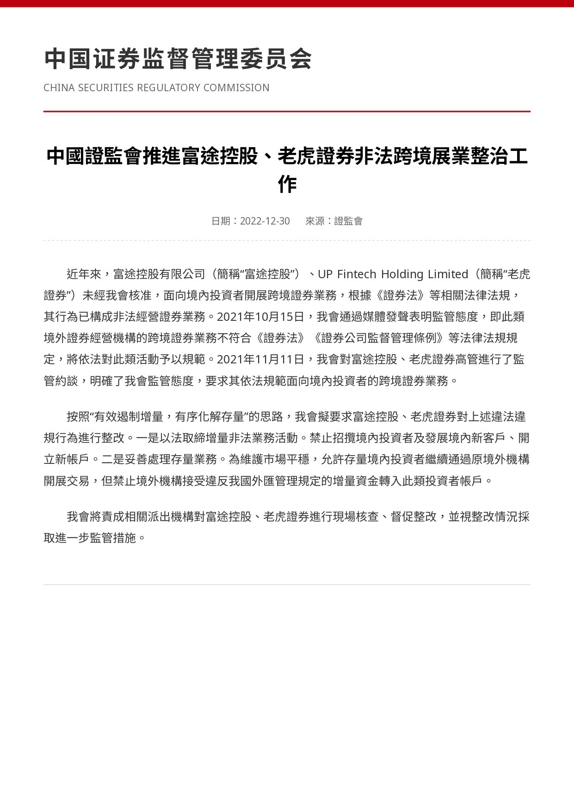
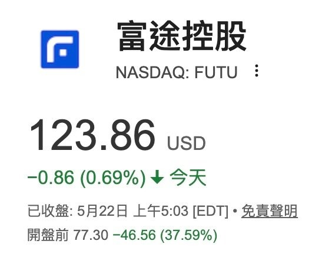
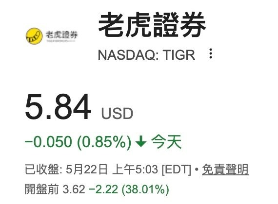

# So Why Not Use Interactive Brokers?

**Date:** 2026-05-22

---

So why not use Interactive Brokers (IB)?

China's securities regulator cracks down hard on illegal cross-border business by Tiger and others
Futu Holdings (FUTU) and Tiger Brokers (TIGR)
both plunged more than 30% premarket

**Part 2**

I thought the CSRC's website was too ugly
so I had AI strip out the cluttered links down the side
and it ended up changing the date too
This is definitely today's news
not 2022
So many eagle-eyed friends out there
Sorry, I went one step too far🤣🤣
I just can't stand a messy UI

## Replies

> Reader: Futu's just for watching the market, ya. If you're putting money in to buy US stocks, of course you go straight to a US broker

True that

> Reader: Asking just in case: what do we use to watch US stocks from now on? Any big shots have a recommendation?

> Reader: Because they were already blocking people from opening accounts overseas

So that was them planning ahead
Now they reel everyone in at once

> Reader: Past me: too lazy
> Present me: finally using the IB account I opened over two years ago

> Reader: Good thing I only use it to watch the market

Looking is free

> Reader: Perfect time to short Futu now, right?

> Reader: If you can think of it, you reckon the Mainland can't? IB has already clamped right down on Mainlanders opening accounts

Any other good routes?

> Reader: Emigrate

> Reader: IB was just in the news in Hong Kong: a retiree had a big chunk of stock transferred out of his account in the small hours.
> Of course, whether his own devices were hacked or it was an IB loophole isn't clear, and there haven't been any similar cases so far

I think I can only set up 3 accounts in my own name

> Reader: They can't open IB accounts either

What other good options are there?

> Reader: Don't kill off Futu, without it there's no good free market-watching app, that'd be such a pain

> Reader: Good thing I use it to watch the market🤣

They'll crawl down your internet cable to bill you🤣🤣

> Reader: Time to fleece the flock?

Emergency whip-round

> Reader: They've run out of US Treasuries to sell

> Reader: Why is the article dated 2022?

I thought the CSRC's website was too ugly
so I had AI redo the image
and strip out all that external-link UI
didn't expect it to change the date too
The correct date is May 22, 2026

> Reader: Good thing I only use Futu to watch the market

If it gets pulled
don't delete the app
you can still keep watching🤣

> Reader: It's from 2022

Sorry😅
I thought the CSRC's website was too ugly
so I had AI strip out the cluttered links down the side
and it ended up changing the date too
This is definitely today's news

> Reader: Buying stocks is another story
> Sure, it's a fact they're pricey
> It's also a fact the UI is good
> And it's a fact you can't buy UK stocks or UCITS ETFs there
> If you're buying through Futu's Hong Kong company
> and you're worried, just keep it under HK$500k
> But even if it really did go bust
> you'd just transfer your holdings to another broker and that's that (of course there'd be other risks, it's not that simple)
> And of course
> switching to IB and steering clear of anything Chinese-owned makes perfect sense too 😂😂

> Reader: Your monthly statements should let you trace what you bought through Futu
> Also, on the US-stock side the US protection is US$500k. But that covers Futu US; no idea whether Futu HK is covered

> Reader: Depends on whether you're with Futu or moomoo
> With Futu, don't even bother, it's only HK$500k

> Reader: HKEX won't cover US stocks, only HK stocks, so does that mean buying US stocks comes with no protection?

> Reader: Is Taiwan in scope too?

Danger app: do not enter (your funds)

> Reader: That's their 2022 announcement, and now they're suddenly cranking up the pressure, huh

My AI messed up
I thought the CSRC's website was too ugly
so I redid the image
and stripped out all that external-link UI
didn't expect it to change the date too
The correct date is May 22, 2026

> Reader: q.futunn.com/feed…
> Futu's put out a statement, everything's running normally, no need to panic like that 🤣

> Reader: IB's deposits and withdrawals, and its UI, are way behind

> Reader: US brokers or Taiwan sub-brokerage accounts both beat Chinese-owned brokers
> Once something gets locked out for political reasons, it usually never comes back

> Reader: Honestly, if they say you've got it, then you've got it😂

> Reader: Holding my spot

> Reader: IB👍

> Reader: Futu's great for watching the market 🤣🤣

---

Original posts:
- Part 1: https://www.threads.com/@edgeless.blade/post/DYoqMPykThm
- Part 2: https://www.threads.com/@edgeless.blade/post/DYoys9-kRTI
