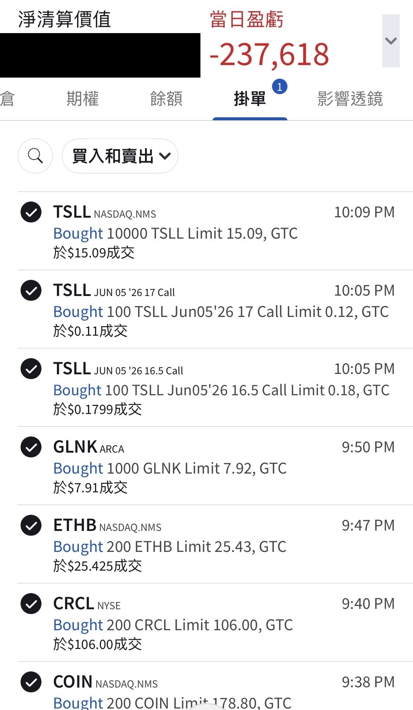

# Another Night of Me Picking Up the Tab

**Date:** 2026-06-02

---

MSTR sold 32 bitcoin
Another night of me reaching into my own pocket to pick up the tab
-US$200,000 in a single day
I bought Coinbase, Circle (USDC's parent company), ETH and Chainlink

If AI agents work their way into every corner of life, someday they'll need on-chain finance
For now I'll just plant a few wards and watch the price

## Replies

> Reader: I hate MicroStrategy

> Reader: You might be down another 200k today. I got suckered into MSTR last Friday. I was up US$2,800 on paper, so I just left it, and then on Monday it flipped to down US$800. Insane. Bailed right away

Bring it on

> Reader: Tesla's mooning

> Reader: Big Bro Heavy Sword is hiding out from the bull market in BTC and TSLA, respect 🫡

always

---

Original post: https://www.threads.com/@edgeless.blade/post/DZEQykMmLu_
