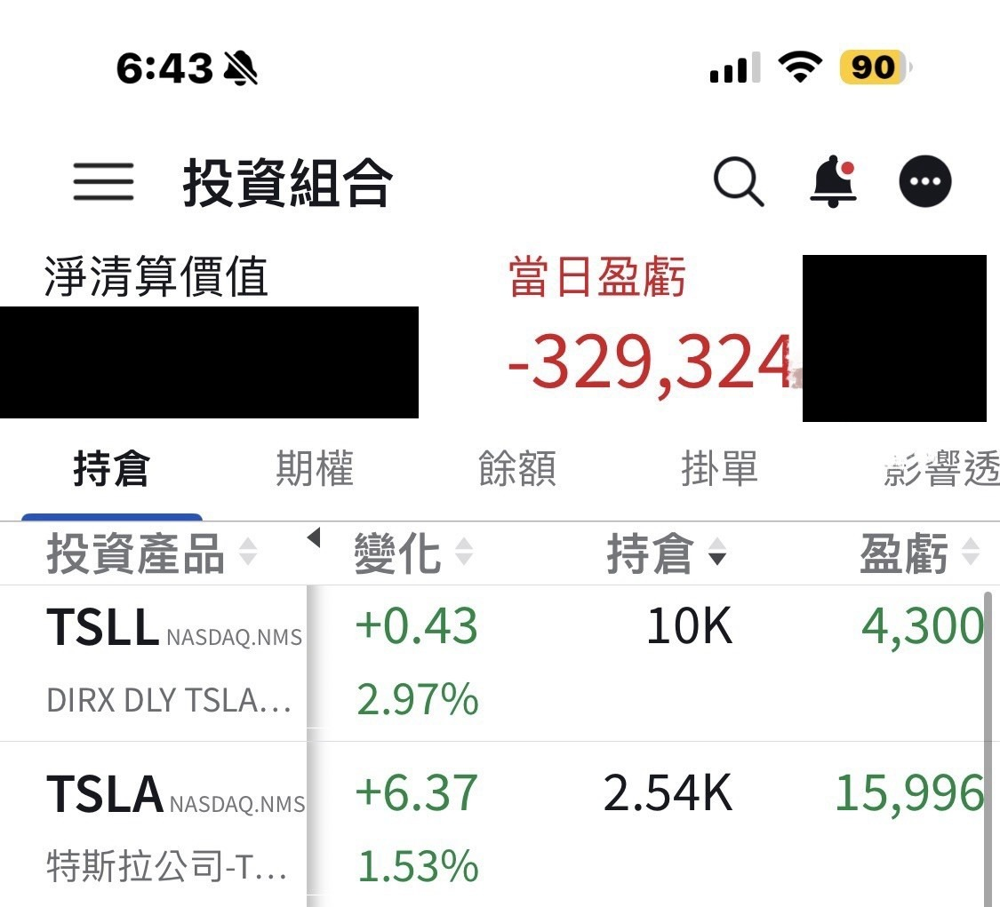

# Did I Invent a Time Machine?

**Date:** 2026-06-03

---

It's 2026
but my account looks like it's 2022
Did I just invent a time machine?

## Replies

> Reader: Tesla, that time machine from my childhood
> keeps me company down on the $400 floor, where everything smells familiar

> Reader: My TSLL is in the red too...

B-but mine's green🥲

> Reader: $600 before year-end, at least $1000 next year. Big bro, you'll be counting 💰 till your hand cramps😅

> Reader: Following you, no wavering

> Reader: This is torture, huddling together for warmth

> Reader: Holding my BTC short, waiting to cover at 30k

> Reader: My cost basis isn't high, but this is real torture😢

With a low cost basis, you can still tough it out
the ones with a high cost basis couldn't tough it out any longer

> Reader: Tesla's mooning

---

Original post: https://www.threads.com/@edgeless.blade/post/DZGmeHeE6El
