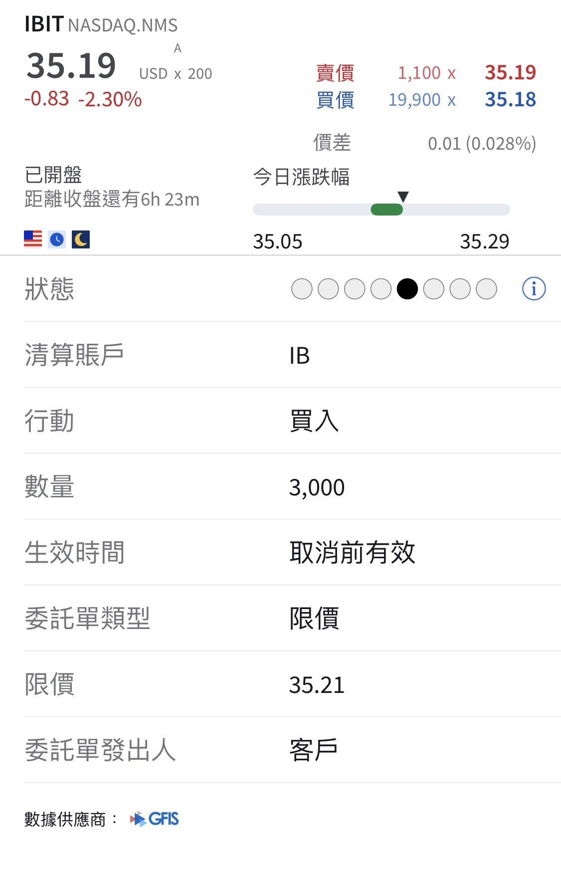

# I Caught US$100,000 of Bitcoin

**Date:** 2026-06-06

---

I caught US$100,000 of bitcoin
When it touches the 200-"week" moving average, you've got to catch an order
It puts you right in with money other people have let settle for four years
Not catching it would let down all you good folks
Catching it might let down my family
So I caught it anyway

## Replies

> Reader: Master Sword buys ibit too? I get the feeling a lot of pro crypto people still prefer to self-custody their bit

Ever since the ETFs came out
I've moved all my spot holdings into ibit
One, it's easy to shift money around between stocks
Two, filing taxes is way simpler and more complete
I think it's a really convenient way to hold

> Reader: One more question, Master Sword: Morgan's msbt has lower fees, so is it better than ibit?

Actually, it works
Enough volume
little slippage
Morgan Stanley's msbt really is a good choice

> Reader: Still waiting for big bro's cost basis: ibit 31

Savage

> Reader: What if I'm buying low, buying low……

Then you've looked after your family and all the good folks at once

> Reader: Daddy Heavy Sword, is this bear market's bottom already behind us😭

> Reader: I'm holding my bitcoin short all the way down to 30k before I cover

---

Original post: https://www.threads.com/@edgeless.blade/post/DZOawrDGPst
