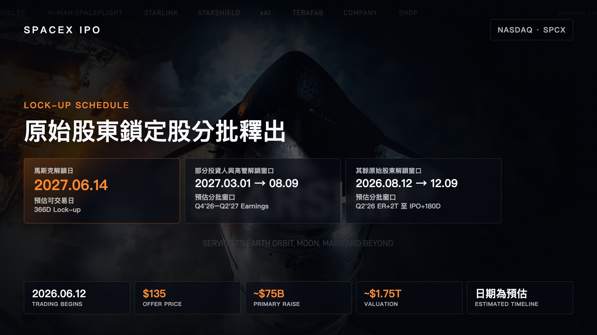

# Investing in SpaceX

**Date:** 2026-06-11

---

Investing in SpaceX
the thing you most need to know
is when the original shareholders' lock-ups expire
Elon Musk unlocks 366 days after the IPO
Some investors and executives unlock in tranches from the Q4'26 earnings report through Q2'27
The remaining original shareholders unlock from the Q2'26 earnings report until 180 days after the IPO
The estimated actual dates are in the chart below:

## Replies

> Reader: As a professional Tesla sucker
> tomorrow I'm buying, no matter the price, I'm buying the heck out of it
> But right now I'm fully bagholding Tesla
> so I've decided to buy one share first, to make placing orders easier later

> Reader: The overvaluation is a fact beyond dispute

> Reader: You missed out that employees can dump their shares straight away

---

Original post: https://www.threads.com/@edgeless.blade/post/DZbknaPEajd
