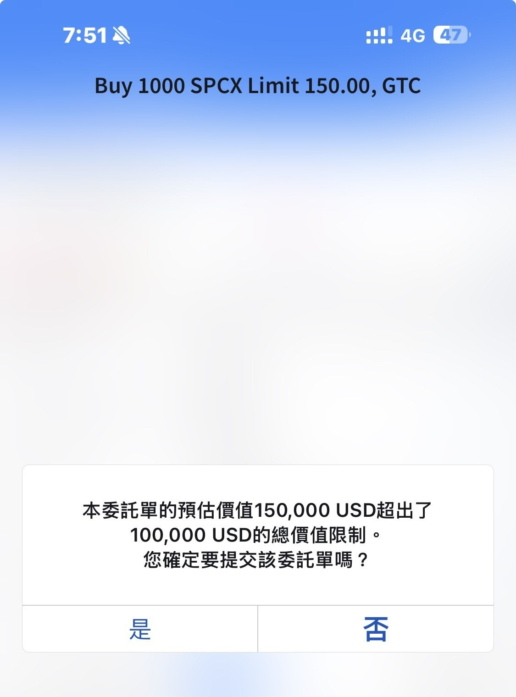
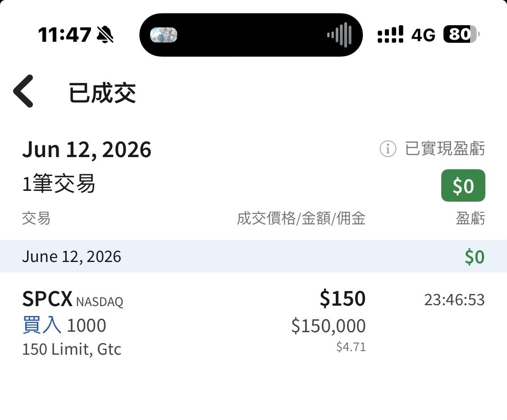

# Applied for 4,500 SpaceX IPO Shares, Got 0

**Date:** 2026-06-12

---

SpaceX IPO
Applied for 4,500 shares through Taiwanese sub-brokerage
Got 0
So I switched to joining the opening cross for 1,000 shares instead

See? There's my 1,000 shares
1,000 shares filled at 150

## Replies

> Reader: Blind guess: it opens above 180

Probably about right
I'm just making up for the regret
Trying my luck in the opening cross
If I get filled, I'm thrilled
just don't want to get filled and then get killed

> Reader: Following with 50 shares 🥹

Well, we're here now

> Reader: The Sword Portfolio
> Ibit tsla spcx QQQ, follow it and you can't go wrong

> Reader: Can you short it?

Wait until share borrowing opens up
and there are no options yet either

> Reader: Damn, let the big bro charge in first🫡🫡

Gotta actually get the shares first

> Reader: Just getting an order in at 150 counts as lucky

> Reader: May I ask which Taiwanese broker? Thanks

In Taiwan, whichever broker it is, I doubt anyone got any

> Reader: My heart's on the small side, I'll just put in 50 first🫠

OK
We'll split the 150

> Reader: Loyal fan here. Bro, will you swap Tesla for this one?

---

Original posts:
https://www.threads.com/@edgeless.blade/post/DZfC89zmHax
https://www.threads.com/@edgeless.blade/post/DZfdJ6EmIcr
