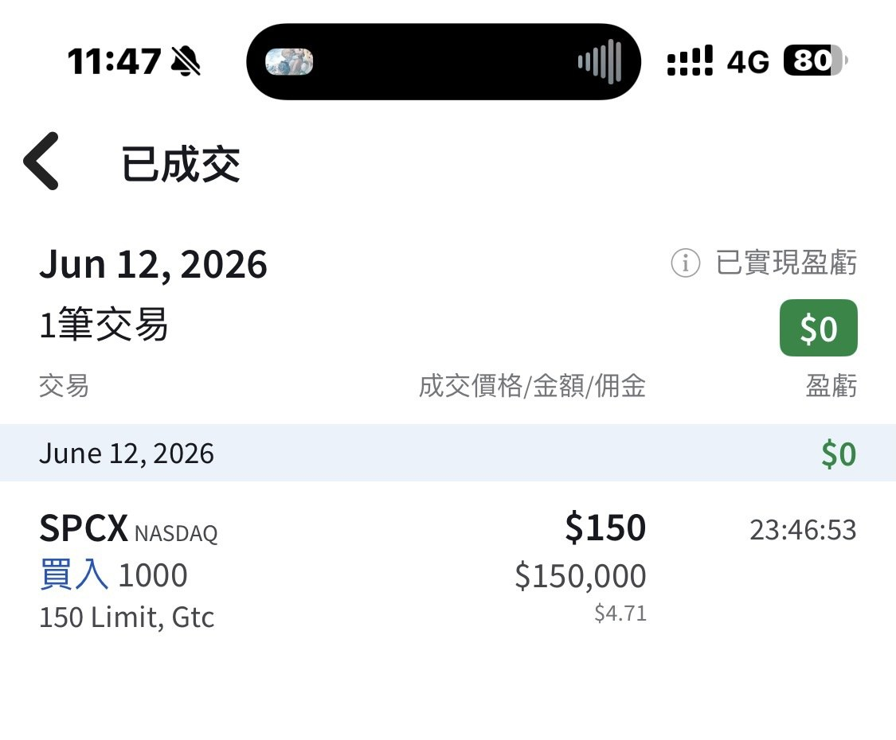
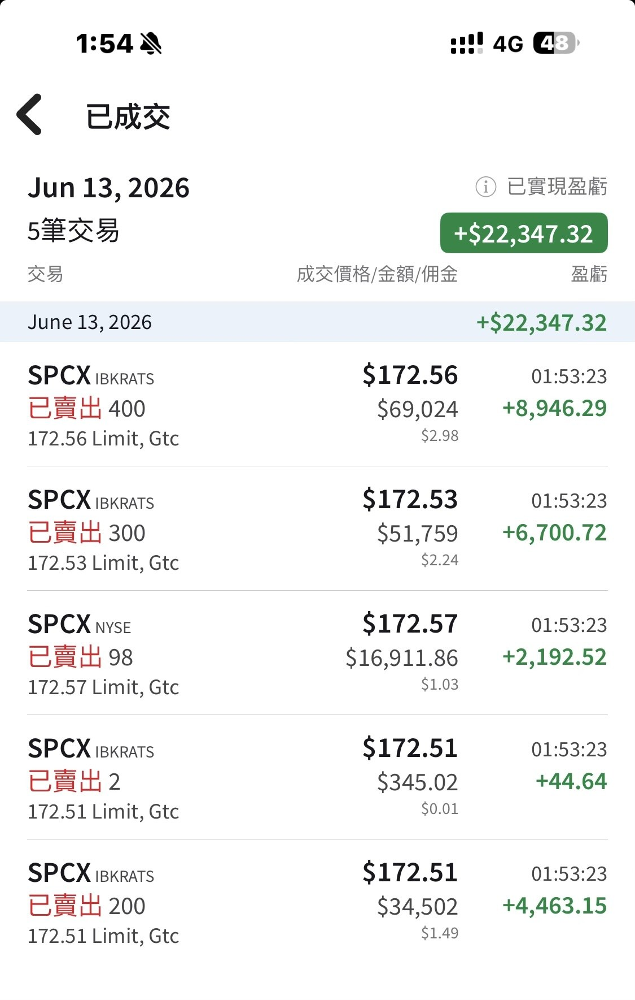

# SpaceX IPO: 1,000 Shares at the 150 Opening Cross

**Date:** 2026-06-12

---

SpaceX IPO
The opening cross matched at 150
Got my 1,000 shares
150 really is the valuation ceiling
Just a starter base position for now

Just sold
Afraid you'd all yell at me
so I'm telling you right away, brothers
Took $22,000 and walked
However I run the numbers, it should still be 150
Putting in 150 to scoop them up again🤣

## Replies

> Reader: Bro, you're not allowed to run, we agreed you'd stay for the value investing

Before bed I put in 161, ready to hop back on
and you guys woke me up again
I so wanna sleep, man😂

In the end, before bed I'd set 150 to buy them back
thought it over and changed it to 161
Filled again😂 1,000 shares
I'm back

> Reader: I'm a high-class SPCX investor

This one isn't that high-priced

> Reader: 150 +1. Master Sword, how high do you think it goes today?

Can't predict
I think 150 is the ceiling of a normal valuation
Hard to hold above that
I'm just building a base position today

> Reader: Didn't get even half a share at 150🥲

> Reader: Lucky you, getting 150👍 All we could do was buy at the open

So you got matched at 150 too, right?

> Reader: Charged in at 160, out at 173🤭

> Reader: Beast mode👍 Winner winner🤩✨

As long as you got some
Come to think of it, good thing it didn't match at 151

> Reader: I got 150 too

Turns out a lot of people got 150

> Reader: I'm all at 150. As long as I make something, no need to push it

It's up👍

> Reader: Rich guy

Don't say that
We're all just making a living in the market

> Reader: 666, so many shares

> Reader: 1,000 shares, a whale

Mid-sized fish at most

> Reader: Just curious, can you buy and sell US stocks the same day?

Sure
And then buy and sell again😆

> Reader: That's godlike😂 but so risky

> Reader: Curious: if you placed an order above 150 before the open, does it also fill at 150? How come it seems like everyone bought at 150

That's how the auction match works
Everything gets matched into one print and fills together
I just happened to put in 150 directly
which happened to be the indicative price
If it had matched at 151 I wouldn't have gotten any

> Reader: I only put in 100 shares on IB, also
> @150
> 🤪
> But I charged in premarket at 200 on hyperliquid, now I'm bagholding🤡
> Should've just waited for the open and gone all-freaking-in lol

> Reader: How do you buy it?

Just put in a 150 limit
The first cross happened to be 150
Everyone at 150 or above was a winner

> Reader: Holy crap, you're a beast

> Reader: Next time we go to Mars you'll be a VIP with premium Martian hospitality, upgraded to first class👍

With this many shares I might just make cabin crew

> Reader: Put in 165 but got filled at 150, happy

Nicely matched

> Reader: Hoping it goes to 50-80

That's a tough ask

> Reader: Did any Taiwanese sub-brokerage get an allocation??

> Reader: 1,000 shares, congrats! Raking it in

> Reader: I also got 12 shares at 150, sold half at 170, a little lunch money, now waiting for the employee and institutional selling later

We're all doing the same thing

> Reader: How come some people can day-trade US stocks?

> Reader: Keep it low-key

Ah, too late🤣

> Reader: Moneybags

It's the taking part that counts

> Reader: Jealous of everyone who got 150, I'm the one getting fleeced🥺

No biggie
Once it goes up, remember to swap back into more

> Reader: Looks like almost everyone who had an order in at the open got 150🫡

> Reader: Seems like a lot of people got 150
> But getting 150 again will be hard
> haha

> Reader: I figured it was already at 175 before the IPO, so I put my order in and slept easy, who knew it'd come down to 150

You still bought at 150
Good order

> Reader: Did you buy this straight through a bank's sub-brokerage?

---

Original posts:
https://www.threads.com/@edgeless.blade/post/DZfda4PmFgN
https://www.threads.com/@edgeless.blade/post/DZfs9n5k79H
