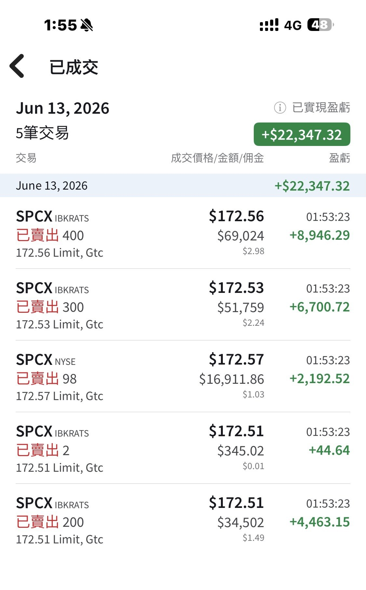
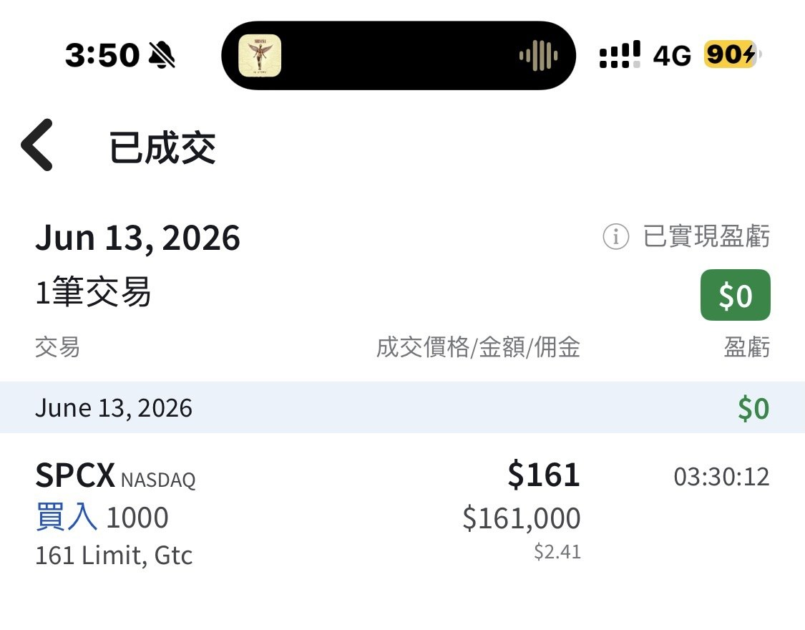

# Zero SpaceX IPO Shares, but Still Made $22,000

**Date:** 2026-06-13

---

For the SpaceX IPO, I applied for several thousand shares through Taiwanese sub-brokerage and wasn't allocated a single one
But I still bought 1,000 shares straight at the open, at 150
and sold them intraday at 172 for one round trip, a $22,000 profit
No allocation, yet a profit like this on day one: I'm more than satisfied
Before the close I put in another buy for 1,000 at 161, and it filled right at the closing price

The reason I go back and forth like this:
the first few days of trading after a big IPO are extremely crowded
turnover is very high, which means
"those inside want out"
"those outside want in"
so the price tends to swing up and down

At this point your own read on valuation matters a lot
-I think 150 is roughly the highest valuation it can sustain in an optimistic scenario
Above that, once the emotion fades, the market cap will be hard to hold, so I'm happy to sell into strength
-150 to 135 is the zone where I'd buy back in
-Below 135 is roughly where I can start preparing my long-term position

The upcoming unlock dates matter a lot too

－Musk can unlock no earlier than June 14, 2027
－Some locked-up investors and executives unlock in stages after the 26Q4 earnings, so the estimated window is March 1 to August 9, 2027
－Other insider holdings (employees, for example) are estimated to unlock from August 12 to December 9 this year
－As for new shares employees subscribed to themselves through the IPO's directed share program: those can trade right away

But whatever you do, don't wait until the reference dates to plan your sale
There are far too many off-exchange ways to lock in a price early
so the best approach is still to think in terms of valuation
Treat the unlock dates only as public market information, background context

## Replies

> Reader: Master Blade, so funny, your prices look a lot like the ones I put in yesterday XD
> 150-135
> (100 was just me tossing one out there to see if it'd hit~)

> Reader: Tesla's ripping

> Reader: Low float is such a rush, swinging back and forth

> Reader: I figured 140 was the safe bet, who knew it'd start from 150

Too bad you didn't get matched

> Reader: I put in 150 but didn't get any!!!

Sold out right when it was your turn?
That can happen?

> Reader: Bro, next time you make a move like this, tell us earlier🥺🥺🥺

I did
I posted yesterday
But it's pretty random
Just call yesterday Lunar New Year come early

> Reader: You bought the lowest and sold the highest on this one, I'm truly in awe

A bit unexpected for me too
Maybe Musk
saw his long-term shareholders hadn't made much
and worked a little miracle

> Reader: Sub-brokerage can't get you any at all🥹

> Reader: For my dad's sub-brokerage I placed direct orders premarket from 150 up to 175, and right at the open they all filled at 150. For myself I only had direct orders at 150 and 155, so those filled at the open too, but the conditional orders at 160, 165, 170 and 175 didn't fill. Cancel them fast and switch to direct orders intraday and you can still get in

---

Original posts:
https://www.threads.com/@edgeless.blade/post/DZhVX7aEfAy
https://www.threads.com/@edgeless.blade/post/DZhVX3ZkQ12
