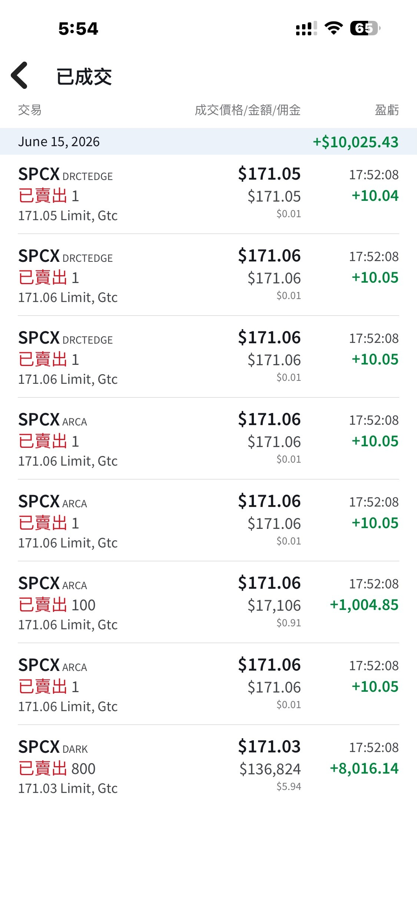
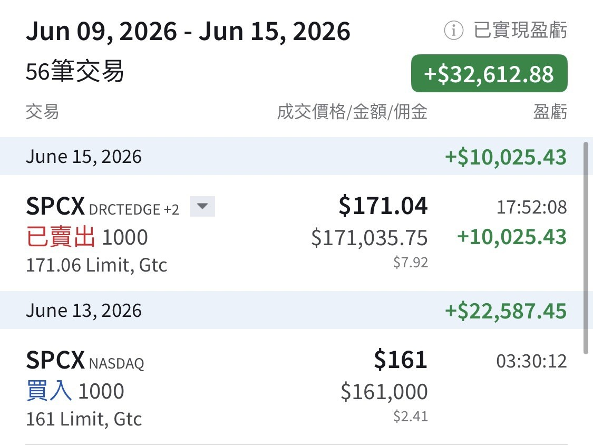

# Picked Up 1,000 SPCX Before Friday's Close

**Date:** 2026-06-15

---

Before Friday's close I picked up 1,000 shares of SPCX
at 161 apiece
Just sold them premarket at 171
profit: exactly $10,000
Waiting for the open to pick some up again
Flipping a big IPO back and forth is the most fun there is

Woke up to 220 after hours
Whoa, it finished consolidating in a single day
The holders are rock solid
I figured those inside wanted out
and those outside wanted in
"Nope!!
Everyone wants in"
220 after hours
the rocket's gone up
and it won't come back down to let anyone catch it with the chopsticks?
All that's left for me is selling puts for a bit of premium

## Replies

> Reader: No worries
> SpaceX's specialty
> is rockets that fly back to be recovered

Give me a pair of chopsticks
I want to catch the rocket one more time🚀

---

Original posts:
https://www.threads.com/@edgeless.blade/post/DZmjHpKka3P
https://www.threads.com/@edgeless.blade/post/DZoLWBQGFEV
