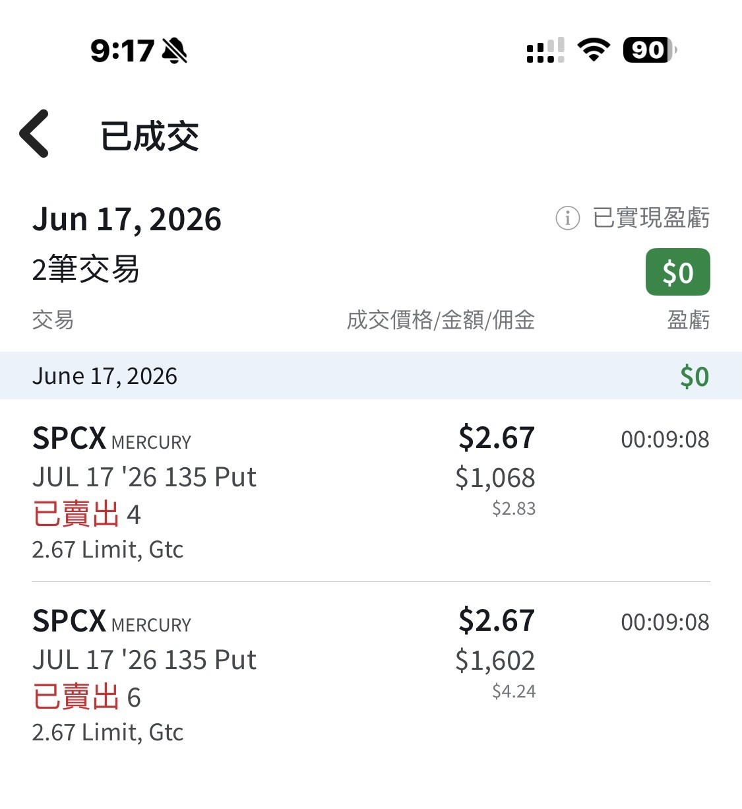

# SPCX Options Are Open

**Date:** 2026-06-17

---

SPCX options are now open
For those of us who didn't win the IPO lottery
but really want to buy at 135, good news
Sell puts on 1,000 shares of SPCX now
collect $2,670 cash up front for 30 days
an easy NT$80,000 a month

No idea what keyword I triggered
I've already deleted 8 scam comments
A few will slip through now and then, so please be careful

## Replies

> Reader: Holy crap, thanks for the heads-up lol

> Reader: $135 is a key level. I think 30 days still carries some risk, but of course if you wanted to buy at the IPO price anyway, it's $2,670 earned on the spot!

The IPO price is prestige itself
worth getting stuck at😺

> Reader: Literally a gimme question

> Reader: Can you buy them back before expiry?

> Reader: The dad of three is racing to the battlefield at full speed

Three kids
are a status symbol of wealth in today's society

> Reader: Keyword: "easy monthly income"

You're right
Makes sense
Normally it's not this concentrated

> Reader: It's about to hit 135. Still planning to buy 1,000 shares?

The position's still on
I'll post it tomorrow

---

Original posts:
https://www.threads.com/@edgeless.blade/post/DZqxy0NmCeF
https://www.threads.com/@edgeless.blade/post/DZqzf2amC82
