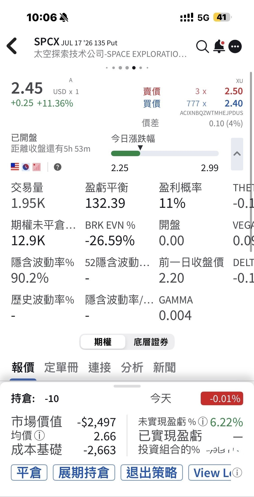

# SPCX Pulled Back Hard Today

**Date:** 2026-06-18

---

SPCX pulled back pretty hard today
A status update for those who saw my sell puts on 1,000 shares earlier
still cashing in😂
But honestly I still really want to catch those 1,000 shares
Looks like the odds are going up🤔

## Replies

> Reader: Where are the 220 bros now XDD

Dunno
Probably cashing in by now

> Reader: Curious, Master Sword, do you always naked sell puts on margin? If it takes one big drop, could you get a margin call?

> Reader: Bought one lot and it dropped? Just buy five more to make it back, duh.

> Reader: Still waiting to set up my shorts. Will I end up as fuel🫠

Shorting is a hard-mode profession

> Reader: The real drop is here
> You're probably in the red now
> Good luck

Catching it at 135 isn't bad
and I got a bonus on top
Wait for me to post the 1,000-share fill
And I've already started my vacation😄

---

Original post: https://www.threads.com/@edgeless.blade/post/DZuvDYjGOdu
