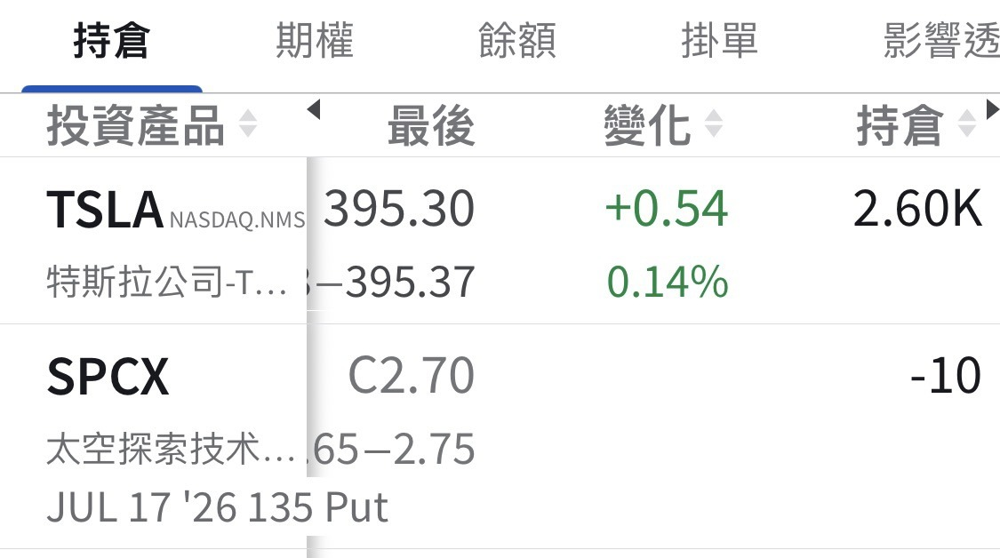

# My SPCX Puts Are Still On

**Date:** 2026-07-14

---

A month ago I sold 10 SPCX puts
Strike price 135
Some friends have been asking whether the position is still on
Lately I've been busy taking my family around Europe
so I've been posting less
The position is still on 🫡
If it hits the strike, I'll take the shares

If I don't get assigned
then I actually have to start thinking
about what price to take shares at next cycle

## Replies

> Reader: Margin for SPCX at IB used to be 100%. Is it still the same now, or has it come down?

> Reader: Any chance it still goes up??

135 should still bounce back and forth for a while
so how to pick the next cycle is what's bugging me more

> Reader: My cost is stuck at 160. @@

> Reader: I bolted a few days ago

Congrats on cashing in
and shaking off the risk too

> Reader: Quick question: if it's at 134, could the other side choose not to exercise?

> Reader: I'm planning to sell puts at a 120 strike

About right
Check the market mood when the time comes

> Reader: Selling the 90s next cycle 😆

90 is probably too far out of the money 😂

> Reader: Friday 6:30 a.m. (UTC+8), the test launch. Will it feel like watching a ball game? 🫠

I used to factor in test-launch results for TSLA's ups and downs too
Super fun

> Reader: 100 hehe

When the time comes, look at the strike and the premium
take shares at a reasonable price
and pocket a reasonable premium

> Reader: I'm going glug glug for now

Drinking more water is a good thing

> Reader: Waiting for Daddy to say add to the position

> Reader: I got my fill the day before yesterday and went off to play August SNDK

> Reader: I thought the group owner had bolted

I did bolt
All the way abroad, for real 🤣

---

Original post: https://www.threads.com/@edgeless.blade/post/Dawu56HkWtP
