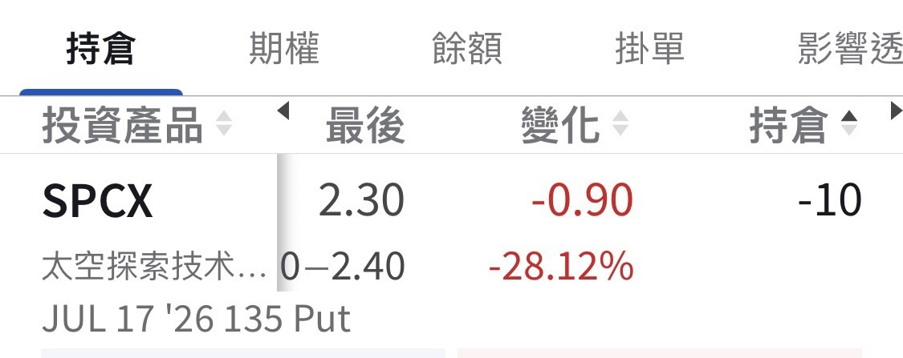

# Two Days Left: Will I Get Assigned 1000 Shares of SPCX?

**Date:** 2026-07-15

---

Two days left
Anyone want to watch live
whether I get assigned 1000 shares of SPCX?

## Replies

> Reader: Any chance it goes below 100? 🤔

That's a bit brutal

> Reader: Master Sword, may I ask: with this put sold on IB, does it automatically turn into shares the moment the price breaks below the strike, or only at expiration? Thanks 🙏

Exercising is the buyer's right
The buyer can hit exercise at any moment
so getting assigned shares before expiration is perfectly normal
But you should be grateful
because the buyer is handing you their time value
Think about it
even a bought put that's already in the money, held as insurance, costs money to buy for just one week
So early exercise is a gift from the buyer to the seller

> Reader: Got it, thank youuu 😊

You're welcome~

> Reader: Heavy Sword daddy, whatever the hell I buy, I always buy it lot by lot

Feels more real that way

> Reader: It's down to 133

Let me take a look

> Reader: Going to close the position?

---

Original post: https://www.threads.com/@edgeless.blade/post/Da0VooLmBw9
