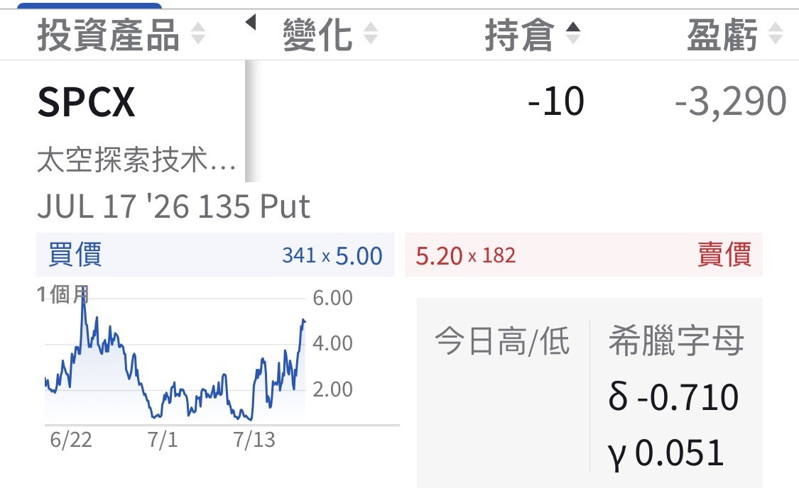

# Am I the Only One Stuck at the SPCX IPO Price?

**Date:** 2026-07-17

---

Woke up to find
am I the only one left stuck holding SPCX at the IPO price?

## Replies

> Reader: Is the 135 about to get exercised?

> Reader: Master Sword, once you catch the shares, will you go straight to CCs?

Of course

> Reader: Not scared!! 😆 I just want to be a shareholder

You like it that much?

> Reader: It's the taking part that counts xddd

> Reader: Stock price successfully recycled

The market successfully recycled me

> Reader: You're not alone, Master Sword

Thank youuu

> Reader: Didn't expect it to get slaughtered this hard

No big deal
Cost and position control is a lifelong lesson

> Reader: True! What you can control is risk management. Nobody can control the market's swings

> Reader: Genuine journey-to-the-center-of-the-earth technology

They researched in the wrong direction

> Reader: And meee

> Reader: SPCX is entirely a carefully constructed "don't look at the present, gaze into the future" affair, with the people selling the stock (Elon Musk and the big banks) painting pie in the sky and spinning stories. The story (the forecast) is told beautifully and leaves people feeling uplifted. As for the Excel numbers linking the company's current business to that future story, they're made up and built on arbitrary assumptions: nobody can confirm whether the $135 IPO price makes sense, or whether it's too high or too low. Once the IPO is done and trading begins, it becomes a contest of how much confidence people have. I think over the next month a few tens of dollars a share would be normal; anywhere in the $20–200 range is normal.

> Reader: Just leave it be for now

> Reader: Talking about dreams in the same chicken coop, I'm dying

> Reader: Long-term investing⋯ hang in there 👍🏻

> Reader: I've been stuck for ages

> Reader: Plenty of people are stuck holding the bag. At this stage, it's safer to assess your position risk first

> Reader: My position was never big anyway. I'll probably dump it today

---

Original post: https://www.threads.com/@edgeless.blade/post/Da4dBFKiCiN
