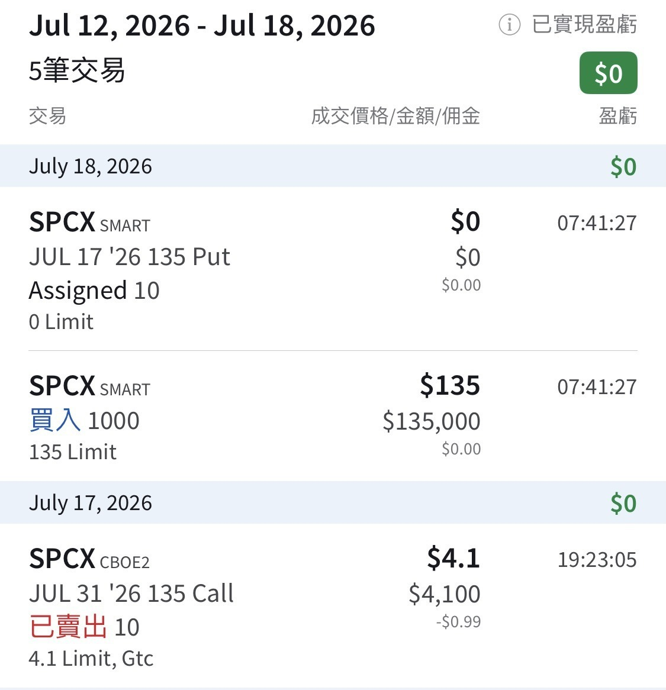

# SPCX Assigned at the IPO Price

**Date:** 2026-07-18

---

Sold 10 SPCX puts
Got assigned 1000 shares today
At the IPO price 🤣
Next step: hawk them at that same price for two weeks
and pocket $4,100 in premium first
Honestly it's just a Taipei City parking space, only a bit more volatile 😁

## Replies

> Reader: Ohhh, so you got assigned. Is congratulations in order?

Paid a little over the odds, but it still counts as good news 😂
It's only the IPO price, after all

> Reader: How much premium did the sell put bring in?

About 2800

> Reader: Feels like the price will dip to around 100⋯

> Reader: 10 trading days left. Nice strike on that CC

> Reader: You could sell naked calls on the 17th? Is that level 4?

Sharp eye 👍 Yes

---

Original post: https://www.threads.com/@edgeless.blade/post/Da7LG-JiI_3
