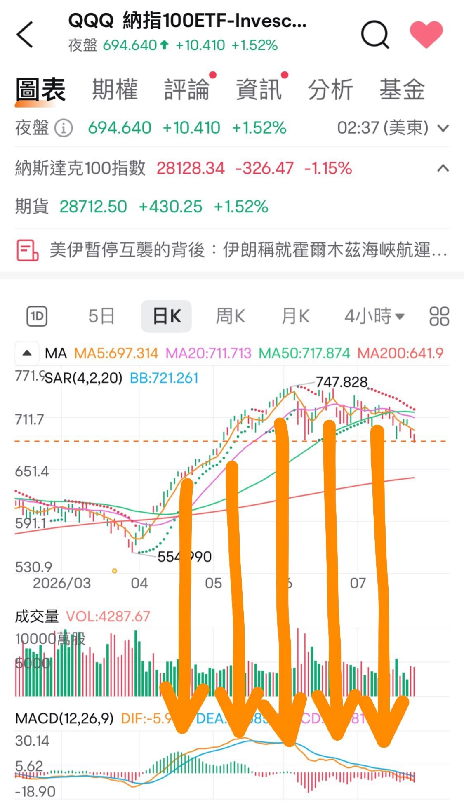

# QQQ Keeps Tracing a Top Divergence

**Date:** 2026-07-27

---

QQQ keeps tracing a top divergence
paired with a surprise Fed rate hike in July

A real 10% pullback to retest
landing right on QQQ's 200-day moving average
is a very possible scenario

But what we need to think about is
how is one hike or two hikes
any different from a rate-hiking cycle in the traditional sense?

Our scenario looks more like there's no room to keep hiking
just 1-2 hikes to rein in inflation and that's enough

So if there's only room for 1-2
rather than a hiking cycle

then the low can be predicted at the moment of peak panic around the 1st-2nd hike

As for QQQ falling 10%
how much does high-beta tsla fall?
My estimate is also 10%
because it was oversold before

As for btc, less than 10%
but if the CLARITY Act doesn't pass
it'll have to catch down
so maybe -15% overall

## Replies

> Reader: That's just brutal

> Reader: A surprise Fed hike in July?
> Are you a time traveler from the future?

I'm talking about this as a scenario

> Reader: Tesla urgently needs a cheap model
> otherwise no matter how high revenue gets
> the margins will get eaten up
> Robots and robotaxis haven't arrived yet
> I'm afraid the money will be burned through first

> Reader: This doesn't really look like a top divergence...

> Reader: The macro environment really isn't right for hikes, it all depends on whether the war can wind down soon

> Reader: Over the weekend I was also looking at roughly 10%

> Reader: Agreed, the dot plot supports this argument

---

Original post: https://www.threads.com/@edgeless.blade/post/DbSXiYUiJm7
