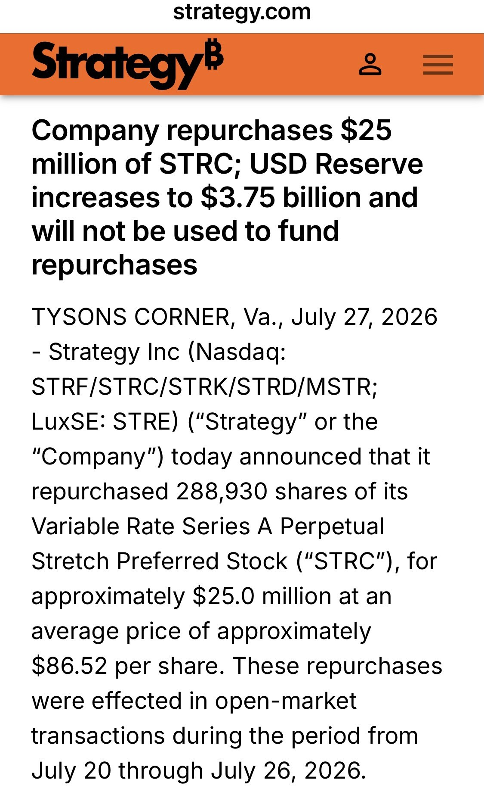

# MSTR Stepped In to Buy Back STRC

**Date:** 2026-07-28

---

mstr stepped in to buy back strc
I don't think it's a good thing
The best way through a crisis of trust is
for STRC to keep paying its dividends steadily
and let the market take the price up or down as it likes
Once mstr
calls out a price line of 86, below which it will buy back
it takes on the duty of holding the price up
When the price falls below 86 again
MSTR = has put itself on the opposite side of the market
The worst outcome is burning through huge amounts of capital fast, trying to hold above 86, then running out of cash and getting knocked flat
I think MSTR's best move has always been
to ignore the STRC price
keep paying dividends
and if it truly has capacity to spare
it can announce a 0.5%-1% dividend increase
and let the market react on its own
rather than promise a price

---

Original post: https://www.threads.com/@edgeless.blade/post/DbVD18vEbvx
