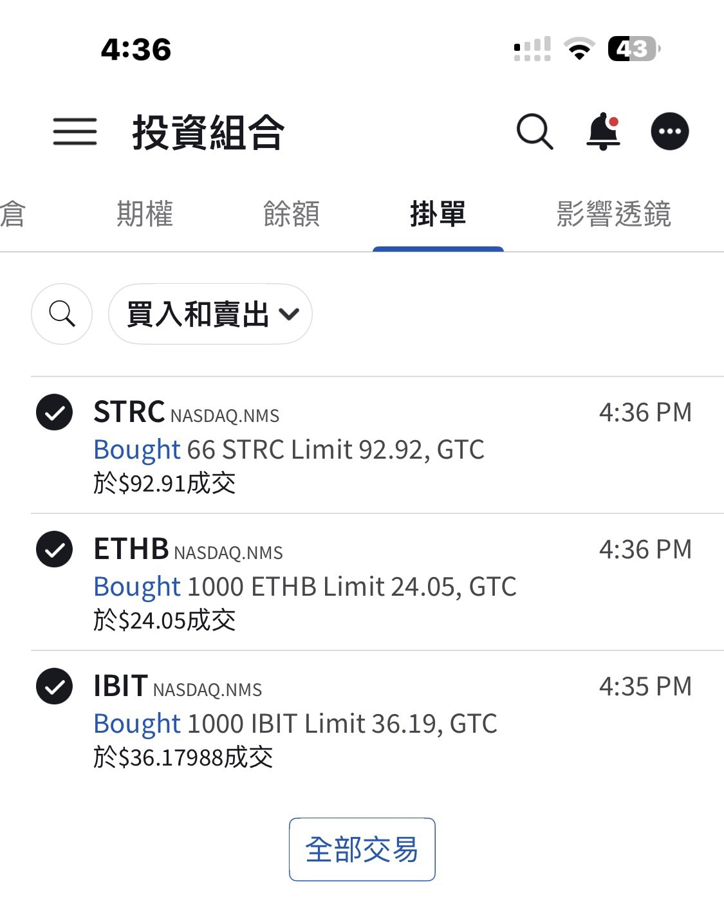
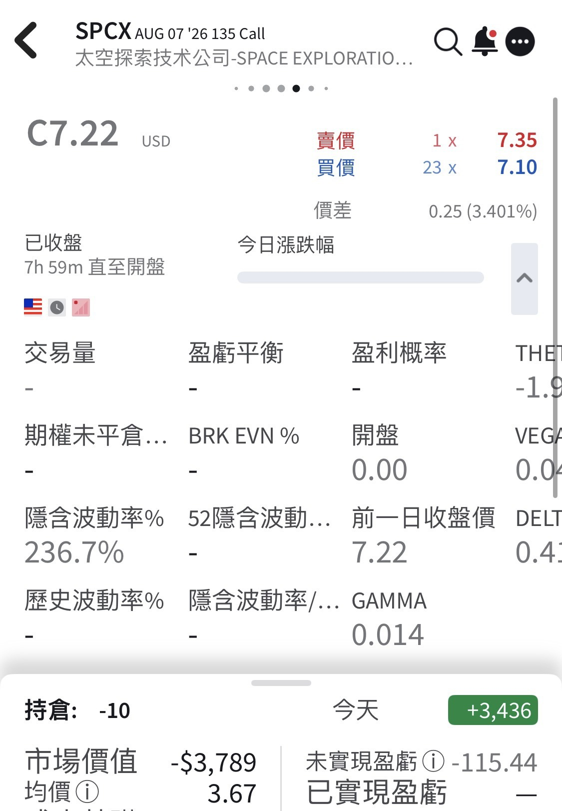

# Clarity Act Odds Fading: Adding IBIT and ETHB, Selling SPCX Calls

**Date:** 2026-08-05

---

The crypto world's Clarity Act
looks less and less likely to pass
I'm sticking to my usual habit
whenever a train looks bound for the center of the earth
the moment it pulls into the station, I get on
Added 1,000 shares each of IBIT and ETHB

My SPCX position hasn't really changed
Selling this week's covered calls again
Sold too early
ten contracts only brought in 3,600

## Replies

> Reader: All aboard🚄

Looks like the tracks up ahead have been torn out, though

> Reader: Guess there'll be a takeoff🛫 service then🤣🤣

Fair point

> Reader: Help

The bill's a mess
and the price doesn't even react
We've truly hit uncharted territory

---

Original post: https://www.threads.com/@edgeless.blade/post/DbpZ9v2CNBc
