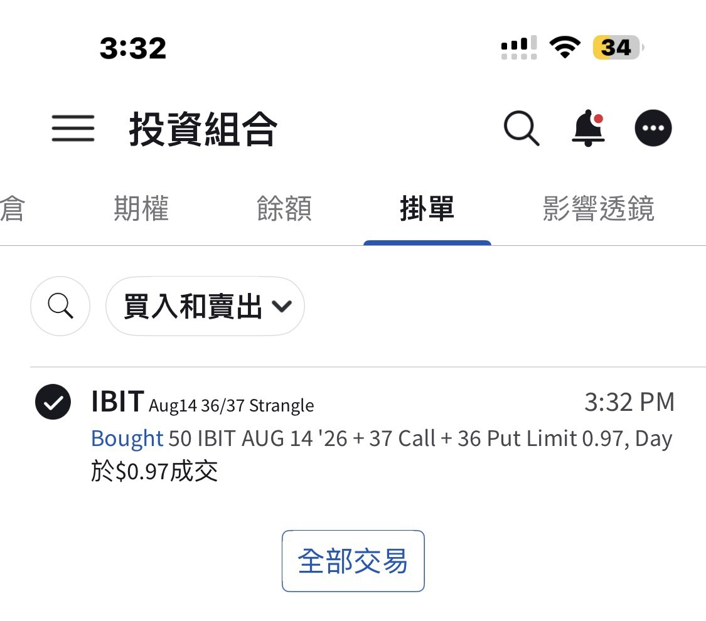

# Clarity Act This Week: A Long Strangle on IBIT

**Date:** 2026-08-06

---

The crypto Clarity Act
should get an outcome this week
And Bitcoin, in the 63,000–64,000 range,
has racked up a huge amount of money changing hands
Time to settle who wins

I went and checked the IV rank on IBIT options
still sitting at a one-year low
So I simply opened 50 contracts of a long strangle for next week
buying both the call and the put, each just a little OTM

Right now there's a chance the Senate voluntarily works overtime and pushes it to next week, so I bought options expiring next week
They won't love their jobs so much they push it to the week after, right🤯
Just go on summer break already, would you

## Replies

> Reader: Going on the offensive?

If it's not going anywhere
could the senators kindly go on summer break
and stop dragging it out🤣

> Reader: Tailing you

You dare follow this one too?
Respect🫡

> Reader: Never played a long strangle before, time to practice

Let's send out a small squad of light cavalry and scout it out together

> Reader: Should HOOD shareholders be shaking right now?

They've been doing great all along

> Reader: Still need Help~~

---

Original post: https://www.threads.com/@edgeless.blade/post/DbsO8dQDmkN
