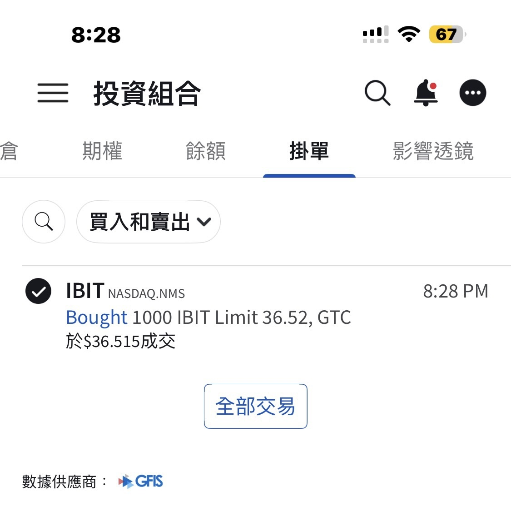

# Clarity Act Delayed, Bitcoin Still Stuck Around 64,000

**Date:** 2026-08-07

---

The Clarity Act is officially pushed back to September
Bitcoin, "surprisingly," is still stuck bouncing around 64,000
The long strangle I opened yesterday, buying volatility on both sides, can be closed today
The nice thing about low IV is there's no IV crush

Yesterday, halfway through a chat with a friend
he suddenly went and bought 500 shares of IBIT
How could I bear to watch him set off alone?
So I had no choice but to cover him with 1,000 shares🤣

## Replies

> Reader: Battery at 67

Sharp eyes, huh

> Reader: That's a really low cost basis

> Reader: It ripped

NFP to the rescue

---

Original post: https://www.threads.com/@edgeless.blade/post/DbuiWa9iF8A
