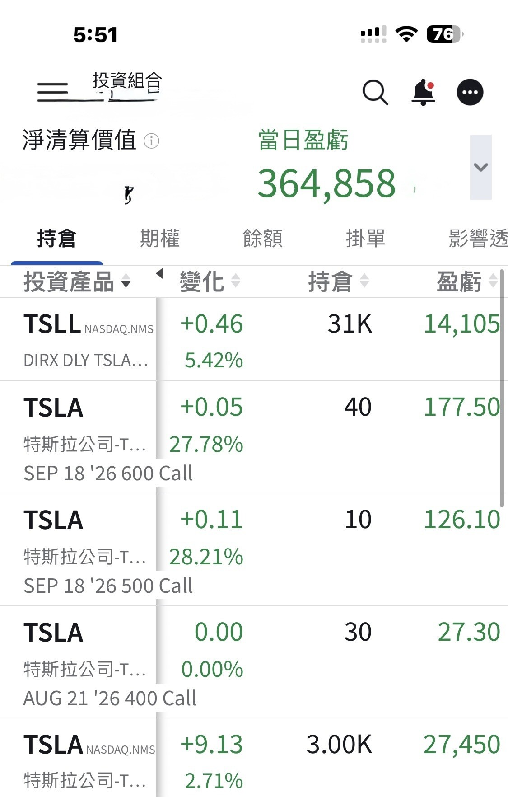
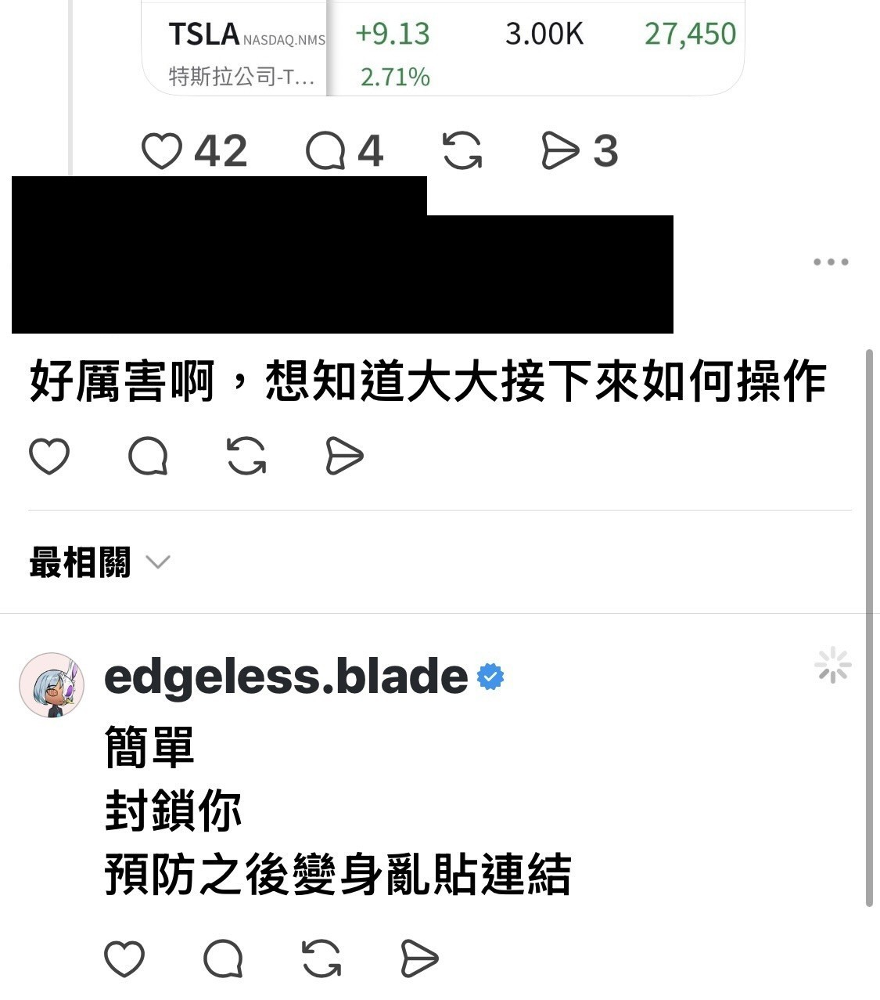

# The Market Is Short on Cash

**Date:** 2026-08-20

---

It's been a long time since I clawed back over 10 million in a single day

The market is short on cash
Market cap and cash are two different things

Market cap can be very high
while the market is still starved for cash

This time the buyback of long-dated Treasuries doubled
easing the duration risk the market had been worried about
and the pricing of risk assets reacted right away
especially companies with negative free cash flow
(yes, that means TSLA 🤣)

There are more and more trillion-dollar monsters in the stock market now
The SPCX IPO alone soaked up a lot of the market's cash
and still to come are the Anthropic and OpenAI IPOs, which should turn into trillion-dollar behemoths too

The market has been short of money for a long time
How do you cure it at the root?
Expand the US dollar money supply again

The good news is
at least we've found where the Bessent put sits😁

## Replies

> Reader: Pretty strange that it still hasn't printed one big candle. Keep adding!

Fierce

> Reader: It's only been 5 days, boss

Really?
Let me go back and check

---

Original post: https://www.threads.com/@edgeless.blade/post/DcQBMApCK27
Thread continuation: https://www.threads.com/@edgeless.blade/post/DcQGu1kCFLf
