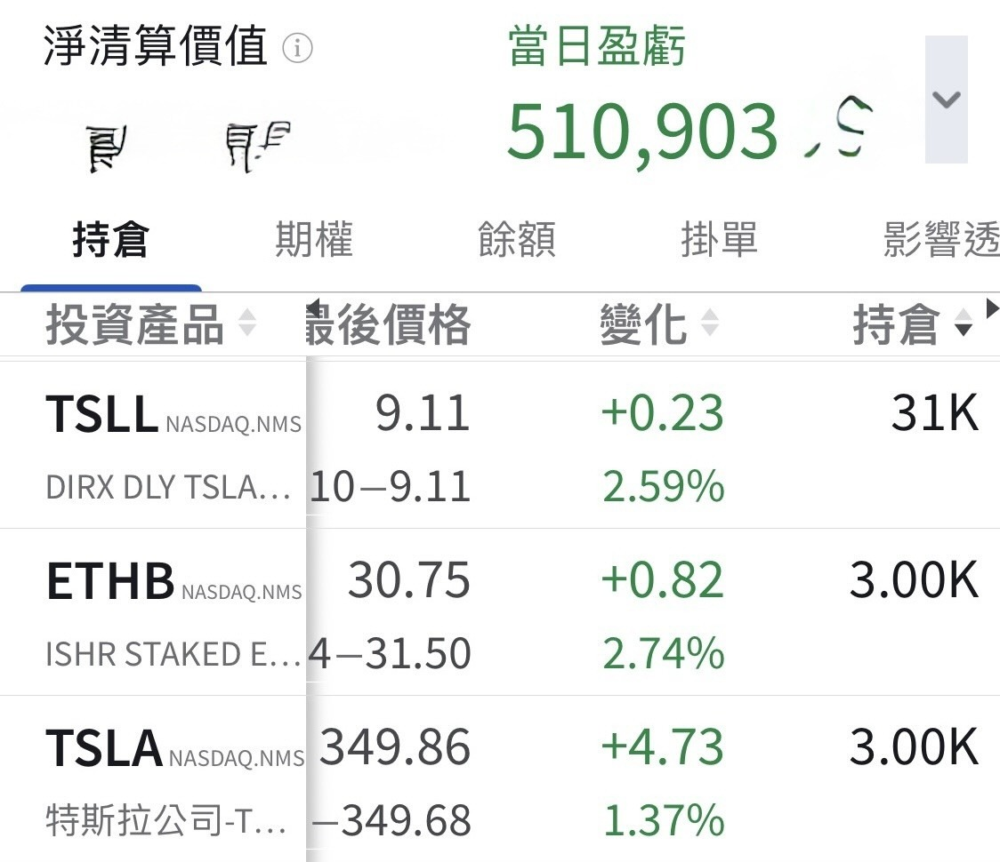

# Ten Years to Turn, Half a Day for Bitcoin

**Date:** 2026-08-21

---

Fortunes take ten years to turn, Bitcoin turned mine in half a day
It really has been a long, long time since I was up US$500,000 in a single day

## Replies

> Reader: Bitcoin's run this time is insane!

The market was way too one-sided before

> Reader: Starting to think about digital gold again😆

> Reader: Dad, can we convert this half day at the old "one day apart feels like three autumns" rate?

Wow, I learned that one as a kid

> Reader: Tesla's ripping

That's next week's show

> Reader: Dad, I told you I'd never give up on you

> Reader: Wow

Investing is hard

> Reader: The king is back

Even king for half a day will do

> Reader: Crypto-stock holders can finally speak up loud

Only quietly
I've got PTSD

---

Original post: https://www.threads.com/@edgeless.blade/post/DcTAOCQEcLO
