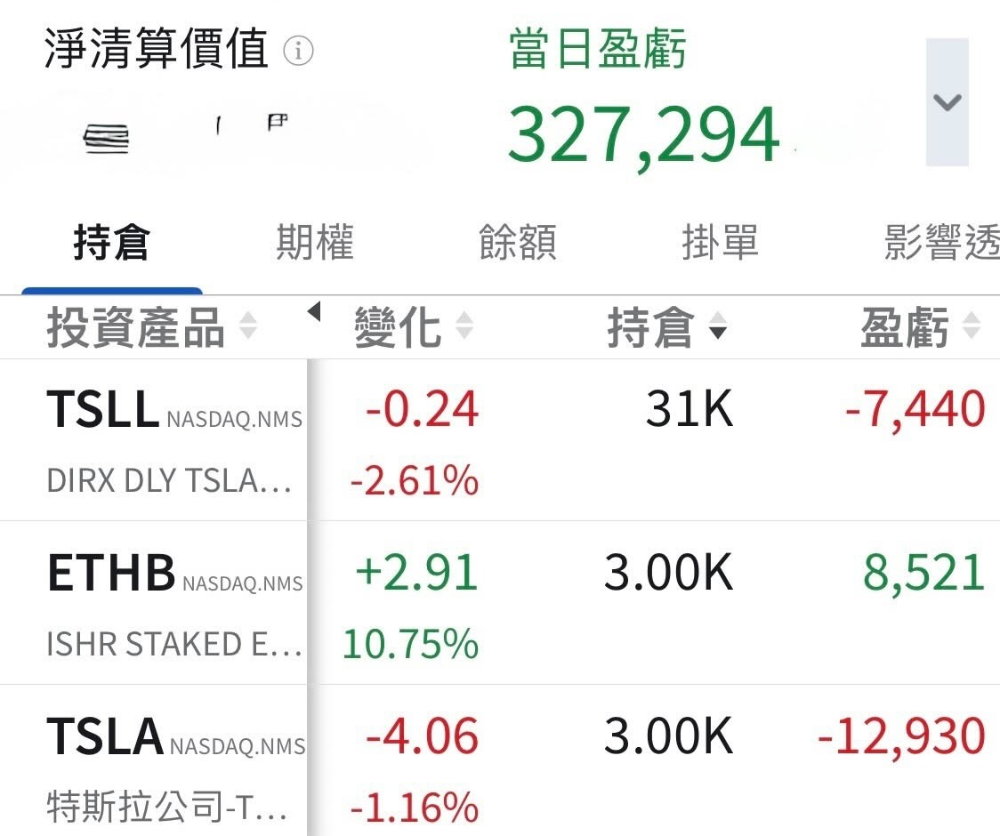

# Where Does the Money Come From?

**Date:** 2026-08-21

---

It's been a long time since I clawed back NT$10 million two days in a row😄

Picking up yesterday's thread
Doubling the long-end buybacks shortens duration
and risk assets get repriced

But think it through
If the long-end "buybacks" double
where does the money come from?

The short end has to double its "issuance" too
And with CPI and PPI being steered by hand
rate-hike expectations will slowly come down as well

You're welcome to bring your questions and join the group
A good group can discuss differing views in a friendly way
🔗Tap my profile picture
Every link in the replies below is a scam

## Replies

> Reader: Good thing not every one of us kids turned out useless

---

Original post: https://www.threads.com/@edgeless.blade/post/DcSl8UnDpe5
