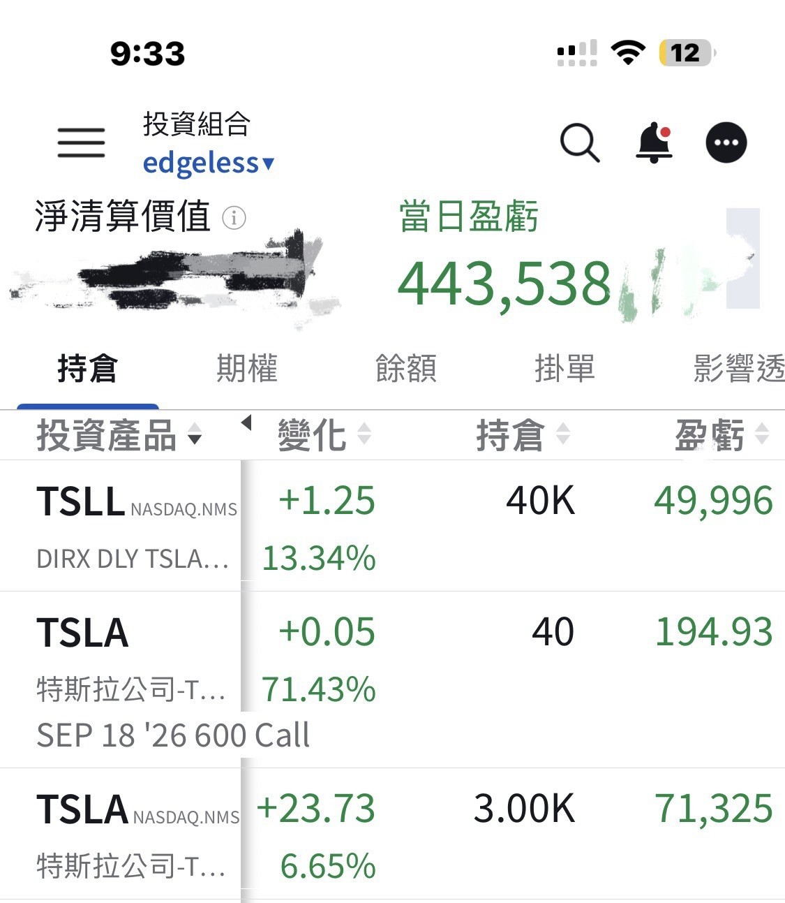
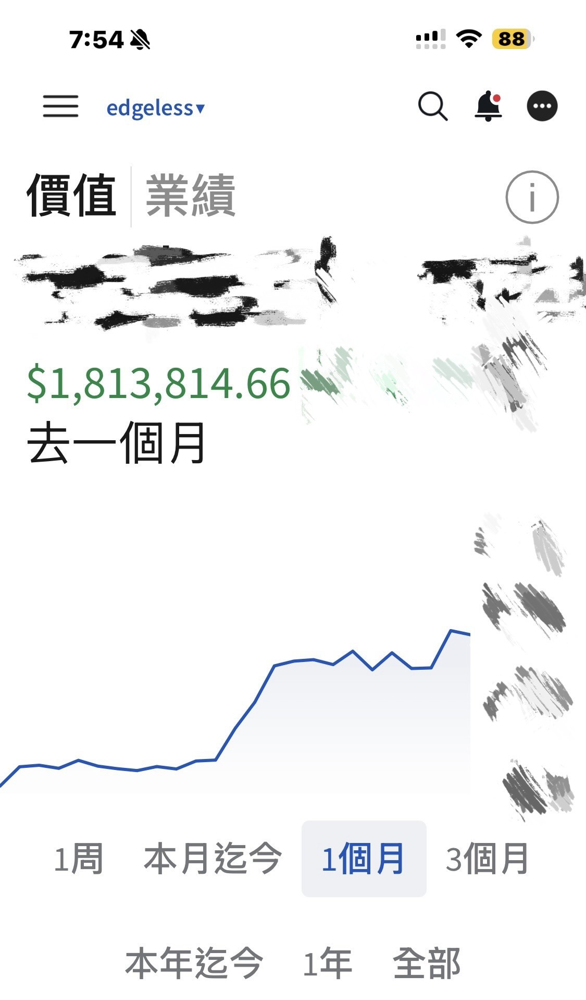

# Bitcoin's 200-Day MA Turns Up

**Date:** 2026-09-04

---

It's over
Bitcoin's 200-day moving average has turned up

You can go back over the historical charts yourself to let it sink in
When a bear-market bottom meets a rising 200-day moving average
it has almost always been a great long-term entry point
And if there's a second or third retest back down to the 200-day, those are great moments too

I hope we can now say
Bitcoin's low is behind us

Are we in some kind of Renaissance lately?
Tesla and Bitcoin are finally coming back to life
Yesterday alone was +$430,000
The past 30 days, +$1.8 million
I went hungry for quite a while this year😅
So the rest of the year is all mine to play with, right?

Apologies to everyone who tried to join the group yesterday
the bot was broken yesterday
It's been fixed today
You can find the link in the portfolio via my profile picture
Any links in the comments below are scams
Please be careful

## Replies

> Reader: Hoping the Twin T's really show up in Q4, so I can grab hold of Master Sword's coattails!

> Reader: So why is it over?

To get you to comment

---

Original post: https://www.threads.com/@edgeless.blade/post/Dc2s2J3iGsZ
