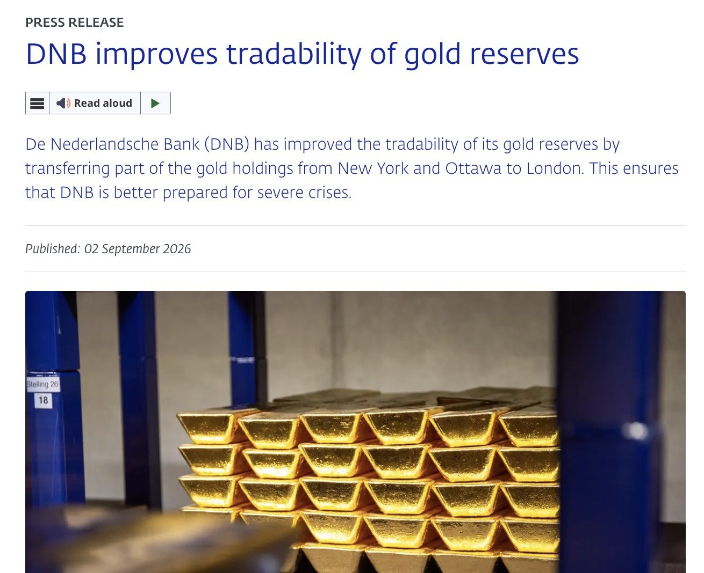

# Maybe the Weather Is Turning

**Date:** 2026-09-06

---

This might be the start of the weather turning

Between March and August this year, the Dutch central bank moved about 86 tonnes of gold that had been held in New York and Ottawa over to London, raising London's share from 18.1% to 32.1%

About 59 tonnes of that were sold in New York and bought back in London; another 27-plus tonnes were shipped home to the Netherlands from the US and Canada

Why move it? The Dutch central bank said it plainly: geopolitical turmoil is intensifying, and crisis preparedness needs to be strengthened. At the same time, it lowers the risk of having storage locations overly concentrated

Cool
Going by my FTX experience
the people who moved their assets out early came out ahead
the ones who kept the faith to the very end, only to find the vault empty, got hit the worst

And how will it get resolved when the time comes?
America: We'll make you whole with an equivalent amount of Treasuries🫶
We happen to be short on Treasury buyers anyway
We'll draw the last few lucky winners from among the world's central banks and compensate you in Treasuries🫶

Let me take you back to another chapter
the gold redemptions by central banks
before the collapse of the Bretton Woods system

1944: the US establishes the Bretton Woods system

1960s: US overseas military spending and Vietnam War deficits push dollar claims beyond America's gold reserves

Around 1965, France under de Gaulle aggressively converts its dollar reserves into gold; the US uses diplomatic pressure to talk other countries out of converting. France is the most prominent converter, but not the only one

**Part 2**

France: 1960–1971, net conversions into gold of about US$2.714 billion
Switzerland: 1960–1971, net conversions into gold of about US$810 million
Netherlands: 1960–1971, net conversions into gold of about US$463 million
Belgium: 1960–1971, net conversions into gold of about US$639 million
Austria: 1960–1971, net conversions into gold of about US$402 million
Spain: 1960–1971, net conversions into gold of about US$707 million
United Kingdom: 1960–1971, net acquisitions of gold of about US$1.78 billion
On August 9, 1971, France still managed to convert US$191 million into gold from the US, six days before the gold window closed
Britain followed right after, asking for US$3 billion of its reserves to be dealt with
On August 15, 1971, Nixon closed the gold window
And the Bretton Woods system fell apart🤣

## Replies

> Reader: I've been chatting with my bot
> going through all kinds of scenarios
> and every line of reasoning ends up in a golden age🥴

The Dharma-Ending Age is upon us

> Reader: Don't be scared, don't be scared
> Feeling a little dizzy at first is normal
> People who never diversified don't even get the chance to feel dizzy

> Reader: Drawing one lucky Treasury buyer live, right here on the spot

---

Original post (Part 1): https://www.threads.com/@edgeless.blade/post/Dc8E4iQDgNf

Original post (Part 2): https://www.threads.com/@edgeless.blade/post/Dc8E4gEDizg
