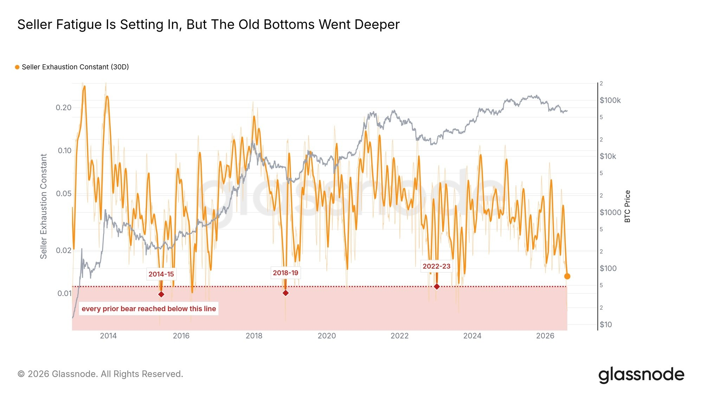

# Bitcoin Only Needs to Do This Once This Year: The Seller Exhaustion Constant

**Date:** 2026-09-08

---

This year, Bitcoin only needs to do this once, right here

For anyone with no position at all
the timing is getting close

Bitcoin's seller exhaustion indicator shows that during 8/11 to 8/21, selling power in the Bitcoin market was exhausted: the indicator hit 0.007, in the lowest 0.3% of all readings since 2010
(The theory is long: I've put it in the next post)

Line that up with how the price moved after all the bad news a month ago
Strategy starts selling bitcoin: Bitcoin price flat
STRC de-pegs to $75: Bitcoin price flat
The CLARITY Act's August vote gets postponed: Bitcoin keeps grinding higher
Coldcard hardware wallets hit by hackers, lots of OG wallets stolen: no big swing in Bitcoin's price

Bad news, no reaction
Maybe this cycle's Bitcoin low is already behind us

For buyers who haven't built a position yet,
$82,000 overhead is a supply zone of selling pressure
The 50-day moving average hasn't officially crossed above the 200-day yet, and the MACD histogram has just turned negative
Maybe there's still time to wait a little longer

When the price pulls back to the 200-"week" moving average again, that may be the best time to buy

*****But remember, time is on the bulls' side

That's just how Bitcoin is
Miss the 5 biggest up days of the year
and your performance over the next year will trail the broader market

**Part 2**

BTC Seller Exhaustion Constant

This is an on-chain quantitative indicator for major-cycle bottoms.

Put simply, it helps you answer one core question: "Has everyone in the market who wants to sell, or ought to sell, already sold out?"

What makes this indicator so fascinating is how perfectly it combines market psychology (profit-and-loss sentiment) with market volatility (trading heat).

Its core calculation is as follows:
* Formula: Seller Exhaustion Constant = Percent Supply in Profit × 30-day Price Volatility

Why does multiplying these two numbers let you "catch the bottom"?

To understand this indicator, we have to take the two factors apart. Each stands for one of the two extreme conditions a market bottom can't form without:

1. Percent Supply in Profit: the "pain level of holders"
* Definition: of all the bitcoin currently in circulation, the share of coins whose price when they last moved on-chain was "lower" than the current market price
* Extreme state: when this value is very low (say, only 45%), more than half the market is trapped and underwater. Retail sentiment at that point is extreme fear and despair.

2. 30-day Price Volatility: the "market's trading vitality"
* Definition: how violently Bitcoin's price has swung up and down over the past 30 days.
* Extreme state: when this value is very low, the market is moving sideways in dead silence. No retail trader wants to trade, there's no good news and no bad news, and the market enters its "boring phase"

🔥The chemistry when you multiply the two

When both sink to extreme lows at the same time, their product, the "Seller Exhaustion Constant", drops to a historic freezing point:
* Reading: everyone in the market is deep in the red (percent in profit extremely low), and the price can't even be bothered to move, lifeless (volatility extremely low). At this point, the ones grimly hanging on are the "long-term true believers (Diamond Hands)", while the retail traders who wanted to cut their losses were washed out long ago in the earlier crash. That is the signal of "total seller exhaustion"

Reading the great historical cycles
Indicator range < 0.007 (even close to 0.005)
Historically, it has appeared only in the most desperate final stretch of bear markets (e.g. late 2015, 2018, 2022). The whole network is underwater, and the market shows no sign of life.

This is a superb buy on the left side of the bottom. Historically, entries here have had an extremely high win rate; it's the golden window for long-term whales to build their positions

## Replies

> Reader: In this wave, having no position is actually simpler: you just wait for a clear level. By comparison, people with positions have it rougher. Holding while it gives back gains, or sitting in cash watching it rise: which is more torturous?
> It's rare to see anyone on Threads seriously sharing about Bitcoin. Definitely giving this a like

Thank you
I'll keep sharing for the long haul🙏
Still, having a base position is very comfortable
It covers the upside risk
On the second test I'll decide whether to add
and how much more
Being in cash covers the downside risk
but leaves you naked to the upside risk
Really it comes down to personal preference
Some people fear downside risk more
Some fear upside risk more
Just do your best to cover the side you worry about, and you'll be comfortable

> Reader: "Miss the 5 biggest up days of the year, and your performance over the next year will trail the broader market"
> That holds even for the S&P 500 or 0050

> Reader: My position's still sitting at 61K, just slowly waiting it out lol

---

Original posts:
- Part 1: https://www.threads.com/@edgeless.blade/post/DdBHRWUDvfI
- Part 2: https://www.threads.com/@edgeless.blade/post/DdBHnMUDr3J
