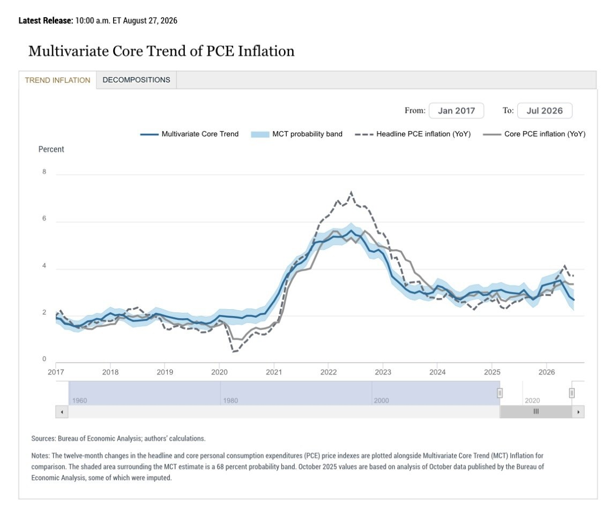

# Four Federal Reserve Bank Tools for Friday's CPI Draw

**Date:** 2026-09-10

---

The CPI lottery draws on Friday

Here are four handy Federal Reserve Bank tools
(links below)
Essential viewing for America's great sages debating the scriptures

Cleveland Fed
Inflation Nowcasting
The data isn't out yet, so what's the estimate for this print?

Dallas
Trimmed Mean PCE
Trim off the most extreme risers and fallers, and what's left in the middle?

Atlanta
Sticky-Price CPI
Are the items that rarely change price going up now too?

New York Fed
Multivariate Core Trend (MCT)
How persistent is inflation?
Is it concentrated in a few items, or broad-based?

Finally, the PCE calculation model is being revised again
If PCE won't come down, we'll just change the formula
Fed research says rising memory prices have distorted the software services price index

The category of the same name in the study makes up about 0.035% of Core CPI and about 1.2% of Core PCE.

It has been announced that on 9/30 the PCE methodology will be revised to add data on game software, information services and so on
It's already too late for the Fed's 9/17 rate decision
but now that the revised method has been put forward
Fed officials, Warsh above all, will naturally have their own way of reading the data

**Part 2**

Cleveland Fed
[clevelandfed.org/indic…](https://www.clevelandfed.org/indicators-and-data/inflation-nowcasting)
Dallas Fed
[dallasfed.org/resea…](https://www.dallasfed.org/research/pce)
Atlanta Fed
[atlantafed.org/resea…](https://www.atlantafed.org/research-and-data/data/sticky-price-cpi)
New York Fed
[newyorkfed.org/resea…](https://www.newyorkfed.org/research/policy/mct)

**Link card:** newyorkfed.org · "Multivariate Core Trend (MCT) Inflation"

## Replies

> Reader: So big-hearted

Gotta give the Fed banks something to do😄

> Reader: Love you, Master Blade🤩

We're all just watching the show either way
This way you get to watch it a lot deeper😄

---

Original posts:
- Part 1: https://www.threads.com/@edgeless.blade/post/DdGIpSxjsFh
- Part 2: https://www.threads.com/@edgeless.blade/post/DdGIto6jks4
