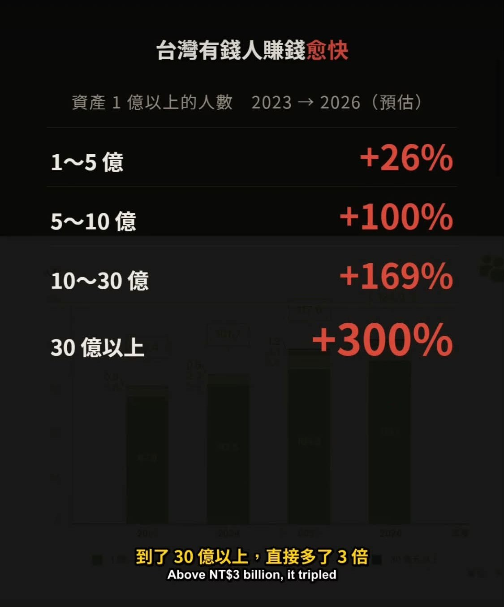

# NT$100 Million Is Life's Escape Velocity

**Date:** 2026-09-18

---

Notice it?
In the world below NT$100 million, you have to add a zero
it takes a 10x before anyone applauds
Above NT$100 million, it actually gets easier and easier
From NT$100 to 500 million you still need 5x, which is a bit tough
From NT$500 million to 1 billion you only need 2x
From NT$1 to 3 billion you only need 3x
No wonder the higher the bracket
the faster the headcount grows
NT$100 million is life's escape velocity
Once you cross it, it gets easy🤣
Turning NT$1 million into NT$3 million
= the same difficulty as taking NT$1 billion to NT$3 billion
Yet people don't feel they've done great
instead they want to speed up even more
That's the problem below NT$100 million

Source: a short video by another creator, as attached to the original post.

## Replies

> Reader: Turning 33.33 million into 100 million is the same difficulty as 1 billion to 3 billion too. So unfair XD

In the first half of a marathon
you need to pace yourself
and save your strength
if investing is a marathon

> Reader: This chart isn't right, is it? The +300% is headcount, not performance. It only shows that the original base of people above 3 billion was tiny

Yes
the chart is about headcount

> Reader: Keep at it💪

Look squarely at what you've achieved
it's all great👍

> Reader: 100 people becoming 400 vs 100,000 becoming 126,000 (hypothetically)

> Reader: Must be nice

---

Original post: https://www.threads.com/@edgeless.blade/post/DdbIDwaDv2m
