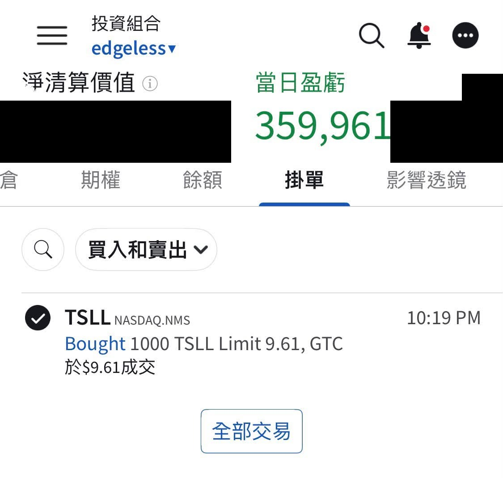

# Wait, Rate Hikes Make Stocks Go Up?

**Date:** 2026-09-19

---

Wait, so rate hikes make stocks go up?
Now I've got a bold idea

## Replies

> Reader: What do you mean, a 350K daily P&L, boss

What about the -75 days
back when I was out roaming the streets?

You've got these stickers too?

> Reader: Plenty of shitposts have them🤣

Are you saying today's post is a shitpost

> Reader: Not at all🤣🤣🤣

> Reader: The bold eat till they burst

There are old sailors
and there are bold sailors
but I've never seen an old bold sailor

> Reader: So a lot of the bold sailors went glub glub glub?

> Reader: Our dear old Tesla should be super rate-sensitive, right? Is it long since priced in, and now just waiting to fill the earlier gap?

A new options structure has just formed
Watch out for sudden good news
like NHTSA

---

Original post: https://www.threads.com/@edgeless.blade/post/Dddfm4UEdnE
