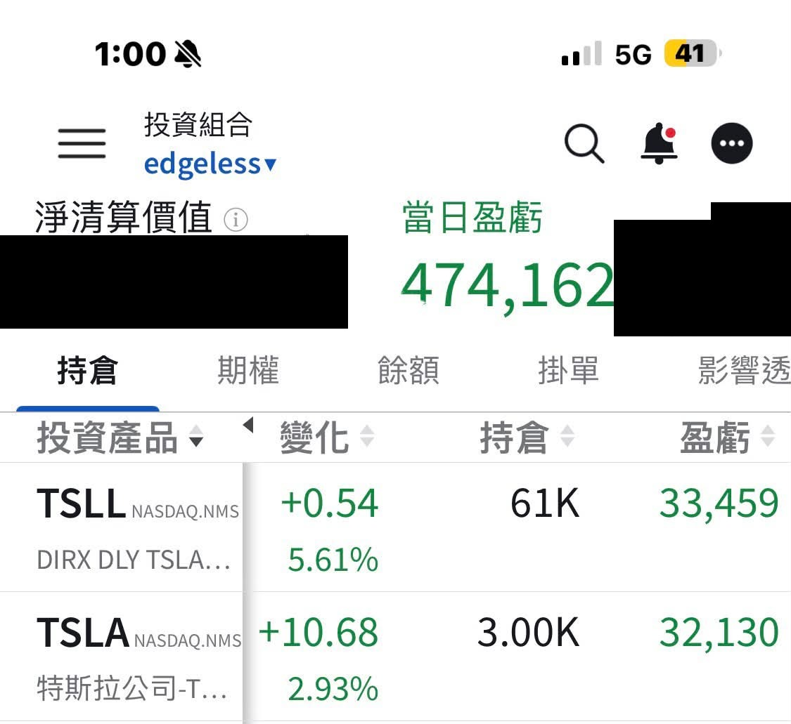

# Time in the Market, Not Timing the Market

**Date:** 2026-09-22

---

Catch a few rallies a year like yesterday's
and your whole year is pretty much made
Basically
everyone wants to dodge the five worst days
but if your holdings miss the five best days
every asset's performance ends up utterly mediocre
On the flip side, let's look at some data
In 2020
the S&P 500 rose 16.26%
Take out the five worst days
and the return soars to 77%
Take out the five best days
and the return becomes a terrifying -19.31%
Timing the market is a double-edged sword
but I'll always choose time in the market

## Replies

> Reader: Stay in the market.

> Reader: "Catch a few rallies a year like yesterday's, and your whole year is pretty much made." Could you switch to YTD so we can see roughly how much more that is?

That's how the smile curve works
every add you make along the way
once you climb past the curve's highest point
each and every one pays you back handsomely
How to size each position
is everyone's own homework

> Reader: You're right

I didn't want to say anything
but it's just gone up way too much

> Reader: Ever since I learned this, I no longer believe people who say sell everything, sit in cash, and wait for a pullback. Keep your money in the market, always🤣

Anyone who finds a strategy that suits them
and keeps making money over the long run
is a lucky person

---

Original post: https://www.threads.com/@edgeless.blade/post/DdlC8H3jlkb
