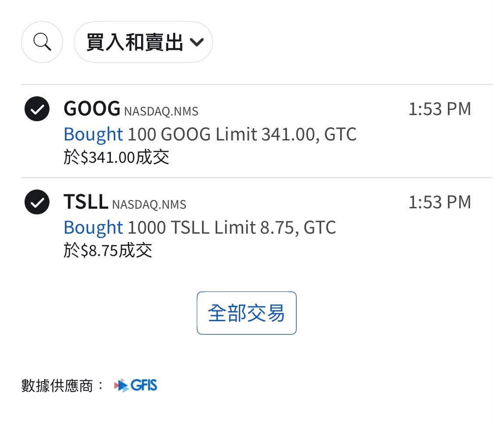

# Adding GOOG, Waiting for META at 640

**Date:** 2026-09-30

---

Honestly, at today's price levels
goog tsla btc qqq
in the short term, everyone can still play it their own way
in the long term, there's only one direction left: up
I opened a GOOG position of 100 shares last week
and just added another 100 shares premarket
Sure, the US 30-year yield has broken 5.5%, but that's no big deal
Leave it to the Treasury's toolbox
I'll still look for chances to build GOOG up to NT$10 million
And remember what I'm saying:
the first day Muse went live
matters no less than the first day Facebook.com went live
I want to buy Meta too
but not now; I'm waiting for 640
Muse is very strong
but what the next two quarters will report is a big jump in costs and depreciation, not revenue
But make no mistake
Muse is Meta's new profit platform for the next 10 years
When it's time to get on board, you have to get on board
Zuckerberg got it right again
My planned entry price for meta is around 640, pretty as a picture
500–600 would be pure free money
It's up to you to seize it
I'm probably giving it a NT$10 million allocation too

## Replies

> Reader: Agreed

You shouldn't play it like this

> Reader: Boss Stork is on board. Is Master Sword scared too? 🤣

Not scared
The ones who weren't scared are all buried

> Reader: Google's long-term value and cash flow are beyond doubt, but adding up to NT$10 million really takes the kind of long-term faith that ignores short-term drawdowns. I agree even more with your call on META, though: Muse agents blowing up like this has really put Zuck on a pedestal.

The problem is the price has run away, and I haven't bought any yet
I can wait a bit longer

---

Original post: https://www.threads.com/@edgeless.blade/post/Dd6TlmSjsE-
